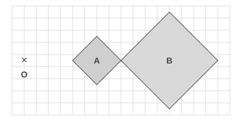
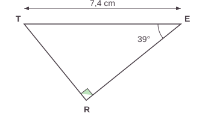
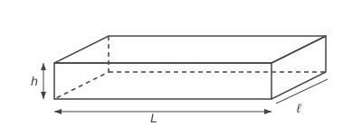
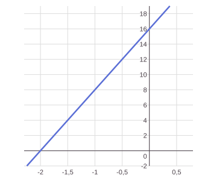
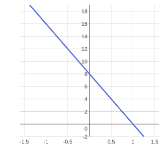
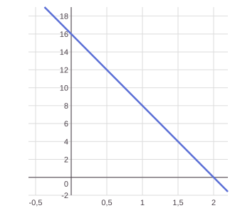

# Annales du brevet 2025 (série générale)

> [!abstract] L'essentiel en 30 secondes
> - Voici le **vrai sujet** de maths du brevet 2025, série générale : mêmes textes, mêmes valeurs, mêmes questions que le sujet officiel.
> - 5 exercices indépendants, 2 h, 100 points : Ex. 1 (20 pts), Ex. 2 (19 pts), Ex. 3 (21 pts), Ex. 4 (21 pts), Ex. 5 algorithmique (19 pts).
> - Calculatrice autorisée (mode examen ou « type collège »). **Toutes les réponses doivent être justifiées**, sauf indication contraire, et une trace de recherche est prise en compte même si le travail n'est pas terminé.
> - Fais d'abord le sujet sans regarder les corrigés, puis compare avec les corrigés (cachés par défaut).

## Le cours

Les **énoncés** sont repris à l'identique du sujet officiel (DNB, session 2025, référence 25GENMATG11, © ministère de l'Éducation nationale). Les **figures** ont été refaites pour le site (mêmes données, dessin simplifié) et les **corrigés** sont écrits pour t'expliquer la méthode : ils ne sont pas le barème officiel.

| Exercice | Thème | Chapitres à revoir |
|---|---|---|
| 1 | QCM | 03 Arithmétique, 04 Calcul littéral, 13 Trigonométrie, 14 Transformations |
| 2 | Statistiques, probabilités, volumes | 09 Statistiques, 10 Probabilités, 15 Géométrie dans l'espace |
| 3 | Programme de calcul, fonctions | 04 Calcul littéral, 05 Équations, 08 Fonctions affines et linéaires |
| 4 | Pythagore, Thalès, proportionnalité | 11 Pythagore, 12 Thalès, 06 Proportionnalité |
| 5 | Probabilités, Scratch | 10 Probabilités, 17 Algorithmique et Scratch |

## Exercices corrigés

### Exercice 1 (20 points)

> [!question] Exercice 1 : QCM
> Cet exercice est un questionnaire à choix multiple (QCM).
> Pour chaque question, quatre réponses sont proposées. **Une seule réponse est exacte.**
> **Recopier sur la copie** le numéro de la question **et** la réponse choisie. Aucune justification n'est demandée.
>
> **Question 1**
> La décomposition en produit de facteurs premiers de 120 est :
>
> | Réponse A | Réponse B | Réponse C | Réponse D |
> |---|---|---|---|
> | $2 \times 3 \times 4 \times 5$ | $15 \times 2 \times 2 \times 2$ | $2^3 \times 3 \times 5$ | $53 + 67$ |
>
> **Question 2**
> Dans la cellule A2, la formule « = − 4 ∗ A1 − 12 » a été saisie. On l'étire jusqu'à la cellule B2. La valeur obtenue dans la cellule B2 est :
>
> | | A | B |
> |---|---|---|
> | 1 | 2 | 5 |
> | 2 | -20 | |
>
> | Réponse A | Réponse B | Réponse C | Réponse D |
> |---|---|---|---|
> | $-32$ | $-20$ | $8$ | $68$ |
>
> **Question 3**
> Sur la figure ci-contre, le rapport de l'homothétie de centre O qui transforme le carré A en le carré B est :
>
> 
>
> | Réponse A | Réponse B | Réponse C | Réponse D |
> |---|---|---|---|
> | $-2$ | $-0{,}5$ | $0{,}5$ | $2$ |
>
> **Question 4**
> Une écriture factorisée de $4x^2 - 1$ est :
>
> | Réponse A | Réponse B | Réponse C | Réponse D |
> |---|---|---|---|
> | $(2x-1)(2x+1)$ | $(4x-1)(4x+1)$ | $4(x-1)(x+1)$ | $(2x-1)^2$ |
>
> **Question 5**
> Dans le triangle TER ci-contre, la mesure de la longueur RE arrondie au centième de cm est :
>
> 
>
> | Réponse A | Réponse B | Réponse C | Réponse D |
> |---|---|---|---|
> | 4,66 cm | 5,75 cm | 9,52 cm | 11,76 cm |

> [!success]- Corrigé de l'exercice 1
> **Question 1 : réponse C.** On divise 120 par des nombres premiers : $120 = 2 \times 60 = 2 \times 2 \times 30 = 2 \times 2 \times 2 \times 15 = 2 \times 2 \times 2 \times 3 \times 5$, soit $\mathbf{2^3 \times 3 \times 5}$. Les réponses A (4 n'est pas premier) et B (15 n'est pas premier) sont des produits mais pas de facteurs premiers. La D est une somme, pas un produit.
>
> **Question 2 : réponse A.** En étirant vers la droite, A1 devient B1. La formule en B2 est donc « = −4 ∗ B1 − 12 » avec B1 = 5 : $-4 \times 5 - 12 = -20 - 12 = \mathbf{-32}$.
>
> **Question 3 : réponse D.** Les deux carrés sont du même côté de O. Le rapport est donc **positif** (pas A ni B). Le carré B est deux fois plus grand que le carré A (sa diagonale fait 8 carreaux, celle de A en fait 4) : le rapport est $\mathbf{2}$. Un rapport de $0{,}5$ rapetisserait la figure.
>
> **Question 4 : réponse A.** C'est une différence de deux carrés : $4x^2 - 1 = (2x)^2 - 1^2 = (2x-1)(2x+1)$. On le vérifie en développant : $(2x-1)(2x+1) = 4x^2 + 2x - 2x - 1 = 4x^2 - 1$.
>
> **Question 5 : réponse B.** Le triangle est rectangle en R, TE est l'hypoténuse. Par rapport à l'angle de $39°$ en E, RE est le côté **adjacent** : on utilise le cosinus.
> $\cos(\widehat{TER}) = \dfrac{RE}{TE}$ donc $RE = 7{,}4 \times \cos(39°) \approx 5{,}75$ cm. **Réponse : 5,75 cm.**

```quiz Sujet 2025 : exercice 1 (QCM)
? Question 1. La décomposition en produit de facteurs premiers de 120 est :
+ $2^3 \times 3 \times 5$
- $2 \times 3 \times 4 \times 5$
- $15 \times 2 \times 2 \times 2$
- $53 + 67$
> 120 = 2 × 2 × 2 × 3 × 5. Dans A et B, il y a 4 et 15, qui ne sont pas premiers.

? Question 2. Dans la cellule A2, la formule « = − 4 * A1 − 12 » a été saisie, puis étirée jusqu'à B2 (A1 = 2, B1 = 5). La valeur obtenue dans la cellule B2 est :
+ $-32$
- $-20$
- $8$
- $68$
> En B2 la formule devient = −4 * B1 − 12 = −4 × 5 − 12 = −32.

? Question 3. Sur la figure, le rapport de l'homothétie de centre O qui transforme le carré A en le carré B est :
+ $2$
- $-2$
- $-0{,}5$
- $0{,}5$
> Les carrés sont du même côté de O, donc le rapport est positif, et B est deux fois plus grand que A.

? Question 4. Une écriture factorisée de $4x^2 - 1$ est :
+ $(2x-1)(2x+1)$
- $(4x-1)(4x+1)$
- $4(x-1)(x+1)$
- $(2x-1)^2$
> $4x^2 - 1 = (2x)^2 - 1^2 = (2x-1)(2x+1)$.

? Question 5. Dans le triangle TER (rectangle en R, TE = 7,4 cm, angle en E de 39°), la longueur RE arrondie au centième de cm est :
+ 5,75 cm
- 4,66 cm
- 9,52 cm
- 11,76 cm
> RE est le côté adjacent à l'angle de 39° : RE = 7,4 × cos(39°) ≈ 5,75 cm.
```

### Exercice 2 (19 points)

> [!question] Exercice 2
> L'entreprise « Transport Rapide » doit livrer cinq colis nommés A, B, C, D et E ayant des masses différentes précisées dans le tableau ci-dessous :
>
> | Nom du colis | A | B | C | D | E |
> |---|---|---|---|---|---|
> | Masse en kg | 4 | 9 | 2 | 7 | 11 |
>
> 1. Calculer la moyenne des masses des colis en kg.
> 2. Déterminer la médiane des masses des colis en kg. Interpréter ce résultat.
> 3. Le transporteur choisit au hasard un colis parmi les cinq (A, B, C, D ou E) pour une livraison express. Calculer la probabilité pour qu'il sélectionne un colis dont la masse est inférieure à 8 kg.
>
> Les colis ont la forme d'un pavé droit de longueur L, de largeur $\ell$ et de hauteur h, représenté ci-dessous.
>
> 
>
> Voici les dimensions des cinq colis.
>
> | Colis | Longueur L en mètre | Largeur $\ell$ en mètre | Hauteur h en mètre |
> |---|---|---|---|
> | A | 0,4 | 0,3 | 0,5 |
> | B | 0,5 | 0,4 | 0,8 |
> | C | 0,3 | 0,1 | 0,5 |
> | D | 0,4 | 0,3 | 0,7 |
> | E | 0,5 | 0,4 | 0,6 |
>
> 4. **a.** Vérifier que le volume du colis E est de $0{,}12$ m³.
>    **b.** L'entreprise souhaite calculer la masse volumique d'un colis dont la formule est rappelée ci-dessous. Montrer que la masse volumique du colis E arrondie au dixième est $91{,}7$ kg/m³.
>
>    *On rappelle que la formule qui permet de calculer la masse volumique d'un objet en kg/m³ est :* $\dfrac{\text{masse (en kg)}}{\text{volume (en m}^3\text{)}}$
>
>    **c.** Le transporteur affirme « Le colis E est plus lourd que le colis C, donc la masse volumique du colis E est plus grande que celle du colis C. » A-t-il raison ?

> [!success]- Corrigé de l'exercice 2
> **1. Moyenne.** On additionne les masses puis on divise par le nombre de colis :
> $\dfrac{4 + 9 + 2 + 7 + 11}{5} = \dfrac{33}{5} = \mathbf{6{,}6}$ kg.
>
> **2. Médiane.** On range les masses dans l'ordre croissant : $2 \;;\; 4 \;;\; 7 \;;\; 9 \;;\; 11$. Il y a 5 valeurs, la médiane est la 3e : $\mathbf{7}$ kg.
> *Interprétation :* au moins la moitié des colis pèse 7 kg ou moins, et au moins la moitié pèse 7 kg ou plus. Ici, 2 colis sont plus légers que 7 kg et 2 sont plus lourds.
>
> **3. Probabilité.** Les colis de masse inférieure à 8 kg sont A (4 kg), C (2 kg) et D (7 kg) : 3 colis sur 5.
> $P = \dfrac{3}{5} = \mathbf{0{,}6}$.
>
> **4. a.** Volume du pavé : $V = L \times \ell \times h = 0{,}5 \times 0{,}4 \times 0{,}6 = \mathbf{0{,}12}$ m³. ✓
>
> **b.** Le colis E pèse 11 kg (voir le tableau des masses) :
> $\dfrac{11}{0{,}12} \approx 91{,}666\ldots$ ; arrondi au dixième : $\mathbf{91{,}7}$ kg/m³. ✓
>
> **c.** Calculons la masse volumique du colis C. Son volume est $0{,}3 \times 0{,}1 \times 0{,}5 = 0{,}015$ m³ et sa masse est 2 kg :
> $\dfrac{2}{0{,}015} \approx 133{,}3$ kg/m³.
> Or $91{,}7 < 133{,}3$ : le colis E est bien plus lourd (11 kg contre 2 kg) mais sa masse volumique est **plus petite** que celle du colis C. **Le transporteur a donc tort** : un colis plus lourd est aussi beaucoup plus gros, ce qui ne dit rien sur la masse volumique.

### Exercice 3 (21 points)

> [!question] Exercice 3
> On considère le programme de calcul suivant.
>
> - Choisir un nombre
> - Multiplier le nombre choisi par $-2$
> - Ajouter 4 au résultat
> - Multiplier le résultat obtenu par 4
>
> 1. Montrer que si l'on choisit 1 comme nombre de départ dans le programme, le résultat obtenu est 8.
> 2. Quel est le résultat si le nombre de départ est $-2$ ?
> 3. Si l'on note $x$ le nombre de départ, montrer que le résultat peut s'écrire $-8x + 16$.
> 4. **a.** Résoudre l'équation $-8x + 16 = 4$.
>    **b.** En déduire le nombre de départ qu'il faut choisir pour obtenir 4 comme résultat.
> 5. Parmi les trois représentations graphiques ci-dessous, quelle est celle qui représente la fonction $f$ définie par $f(x) = -8x + 16$ ? Expliquer la démarche.
>
> **Représentation graphique 1**
>
> 
>
> **Représentation graphique 2**
>
> 
>
> **Représentation graphique 3**
>
> 

> [!success]- Corrigé de l'exercice 3
> **1.** Départ : $1$. Étape 2 : $1 \times (-2) = -2$. Étape 3 : $-2 + 4 = 2$. Étape 4 : $2 \times 4 = \mathbf{8}$. ✓
>
> **2.** Départ : $-2$. Étape 2 : $(-2) \times (-2) = 4$. Étape 3 : $4 + 4 = 8$. Étape 4 : $8 \times 4 = \mathbf{32}$.
>
> **3.** Avec $x$ au départ : $x \;\to\; -2x \;\to\; -2x + 4 \;\to\; 4(-2x + 4)$.
> On développe : $4 \times (-2x) + 4 \times 4 = \mathbf{-8x + 16}$. ✓
>
> **4. a.** $-8x + 16 = 4$
> $-8x = 4 - 16 = -12$
> $x = \dfrac{-12}{-8} = \dfrac{3}{2} = \mathbf{1{,}5}$.
>
> **b.** Le résultat du programme est $-8x + 16$. Il vaut 4 quand $x = 1{,}5$ : il faut choisir **1,5** au départ. *(Vérification : $1{,}5 \times (-2) = -3$ ; $-3 + 4 = 1$ ; $1 \times 4 = 4$. ✓)*
>
> **5.** $f(x) = -8x + 16$ est une fonction affine $f(x) = ax + b$ avec $a = -8$ et $b = 16$.
> - $a = -8 < 0$ : la droite est **décroissante**. On élimine la représentation 1, qui monte.
> - $b = 16$ : la droite coupe l'axe des ordonnées au point d'ordonnée **16**, car $f(0) = 16$. On élimine la représentation 2, qui coupe cet axe en 8.
> - Vérification avec la représentation 3 : $f(2) = -8 \times 2 + 16 = 0$, la droite passe bien par le point $(2\,;\,0)$.
>
> **C'est donc la représentation graphique 3.**

### Exercice 4 (21 points)

> [!question] Exercice 4
> Un agriculteur souhaite cultiver un champ représenté par le triangle ABC ci-contre.
> Sur la figure qui n'est pas à l'échelle, on a les informations suivantes :
>
> ![Figure de l'exercice 4 : triangle ABC rectangle en B, avec D sur [BC] et E sur [AC]](annales-2025/ex4-triangle-ABC.svg)
>
> - le triangle ABC est rectangle en B ;
> - les points C, E et A sont alignés ;
> - les points C, D et B sont alignés ;
> - AB = 600 m ; BC = 450 m ; CD = 270 m.
>
> *Les parties A et B sont indépendantes.*
>
> **Partie A : étude géométrique du terrain**
>
> 1. Montrer que le segment [AC] mesure 750 mètres.
> 2. **a.** Montrer que les droites (ED) et (AB) sont parallèles.
>    **b.** Montrer que le segment [DE] mesure 360 mètres.
> 3. Montrer que l'aire du triangle CDE est 48 600 m².
>
> **Partie B : étude du prix du mélange de graines**
>
> L'agriculteur souhaite semer un mélange de graines (blé, seigle et pois) en respectant les indications suivantes.
>
> | **Indication 1 :** prix au kilo pour chaque type de graine | **Indication 2 :** répartition du type de graines pour une surface de 10 000 m² |
> |---|---|
> | Blé : 1,40 €/kg | Blé : 80 kg |
> | Seigle : 1,30 €/kg | Seigle : 60 kg |
> | Pois : 2,10 €/kg | Pois : 50 kg |
>
> 1. Un vendeur lui propose des sacs contenant un mélange de blé, seigle, et pois selon le ratio 16 : 12 : 8. Montrer que la composition de ce sac ne respecte pas l'indication 2.
> 2. L'agriculteur souhaite semer le mélange de graines sur la partie du champ représentée par le triangle CDE dont l'aire mesure 48 600 m². Il a calculé qu'il doit prévoir 388,80 kg de blé pour respecter la répartition indiquée dans l'énoncé. Justifier le calcul de l'agriculteur.
> 3. L'agriculteur dispose d'un budget de 1 500 € pour semer le mélange de graines sur la totalité des 48 600 m² de terrain. Il a calculé qu'il doit acheter 388,80 kg de blé, 291,6 kg de seigle et 243 kg de pois pour respecter la répartition indiquée dans l'énoncé. L'agriculteur dispose-t-il d'un budget suffisant ?

> [!success]- Corrigé de l'exercice 4
> **Partie A**
>
> **1.** Le triangle ABC est rectangle en B, donc d'après le **théorème de Pythagore** :
> $AC^2 = AB^2 + BC^2 = 600^2 + 450^2 = 360\,000 + 202\,500 = 562\,500$.
> $AC = \sqrt{562\,500} = \mathbf{750}$ m. ✓
>
> **2. a.** Sur la figure, le triangle CDE est rectangle en D : $(ED) \perp (BC)$. Le triangle ABC est rectangle en B : $(AB) \perp (BC)$. Deux droites perpendiculaires à une même troisième droite sont parallèles entre elles, donc $(ED) \parallel (AB)$. ✓
>
> **b.** Les points C, D, B sont alignés, les points C, E, A sont alignés et $(DE) \parallel (AB)$ : d'après le **théorème de Thalès**,
> $\dfrac{CD}{CB} = \dfrac{CE}{CA} = \dfrac{DE}{AB}$, soit $\dfrac{270}{450} = \dfrac{DE}{600}$.
> $DE = \dfrac{270 \times 600}{450} = \dfrac{162\,000}{450} = \mathbf{360}$ m. ✓
>
> **3.** Le triangle CDE est rectangle en D, donc son aire est :
> $\mathcal{A} = \dfrac{CD \times DE}{2} = \dfrac{270 \times 360}{2} = \dfrac{97\,200}{2} = \mathbf{48\,600}$ m². ✓
>
> **Partie B**
>
> **1.** Dans l'indication 2, la répartition est $80 : 60 : 50$. Dans le sac, le ratio est $16 : 12 : 8$. Si le sac respectait l'indication 2, on obtiendrait les mêmes quotients pour chaque graine :
> $\dfrac{80}{16} = 5$ ; $\dfrac{60}{12} = 5$ ; mais $\dfrac{50}{8} = 6{,}25 \neq 5$.
> Les quantités ne sont pas proportionnelles : **le sac ne respecte pas l'indication 2** (il y a trop peu de pois par rapport au blé et au seigle).
>
> **2.** 80 kg de blé suffisent pour 10 000 m². La quantité de blé est proportionnelle à la surface :
> $\dfrac{80 \times 48\,600}{10\,000} = 80 \times 4{,}86 = \mathbf{388{,}8}$ kg. ✓
> *(48 600 m² représentent 4,86 fois 10 000 m².)*
>
> **3.** On calcule le prix de chaque graine :
> - blé : $388{,}8 \times 1{,}40 = 544{,}32$ €
> - seigle : $291{,}6 \times 1{,}30 = 379{,}08$ €
> - pois : $243 \times 2{,}10 = 510{,}30$ €
>
> Total : $544{,}32 + 379{,}08 + 510{,}30 = \mathbf{1\,433{,}70}$ €.
> Comme $1\,433{,}70 < 1\,500$, **le budget est suffisant** (il lui reste $66{,}30$ €).

### Exercice 5 (19 points) : algorithmique

> [!question] Exercice 5
> Un digicode commande l'ouverture de la porte d'entrée de la maison de la grand-mère de Léna.
> Léna a oublié le code. Elle sait qu'il est composé d'une lettre A, B, ou C, suivie d'un chiffre compris entre 0 et 9.
>
> 1. Proposer deux codes différents que Léna peut tester.
> 2. Quelle est la probabilité que la grand-mère de Léna ait choisi la lettre C dans son code ?
> 3. Montrer que la probabilité que la grand-mère de Léna ait choisi le chiffre 7 dans son code est $\dfrac{1}{10}$.
> 4. Léna se souvient que sa grand-mère, enseignante de mathématiques à la retraite, aime bien les nombres premiers. Quelle est la probabilité que le code choisi par sa grand-mère comporte un nombre premier ?
> 5. **a.** Léna décide de tester tous les codes possibles. Elle estime qu'il lui faut 5 secondes pour essayer un code. Réussira-t-elle à ouvrir la porte de la maison en moins de 3 minutes ?
>    **b.** Le format de ce code garantit-il la sécurité de la maison ? Comment pourrait-on améliorer ce système de code ?
> 6. Chaque fois qu'un utilisateur saisit un code, un programme lui annonce si le code est correct ou faux. Le programme utilisé est noté ci-dessous.
>
>    Programme Scratch :
>    - quand 🏴 est cliqué
>    - demander « Saisir une lettre parmi A, B et C » et attendre
>    - mettre *lettre saisie* à *réponse*
>    - demander « Saisir un chiffre entre 0 et 9 » et attendre
>    - mettre *chiffre saisi* à *réponse*
>    - si (*lettre saisie* = B) **et** (*chiffre saisi* = 7) alors : dire « Code correct » pendant 2 secondes
>    - sinon : dire « Code faux » pendant 2 secondes
>
>    **a.** Léna saisit le code B5. Qu'affiche le programme ?
>    **b.** D'après ce programme, quel est le code qui permet d'entrer dans l'immeuble de la grand-mère de Léna ?

> [!success]- Corrigé de l'exercice 5
> **1.** Un code = une lettre (A, B ou C) puis un chiffre. Par exemple **A0** et **C9** (ou B5, A3…).
>
> **Nombre de codes possibles.** 3 lettres × 10 chiffres = **30 codes**, tous équiprobables. On l'utilise dans toutes les questions suivantes.
>
> **2.** Les codes avec la lettre C : C0, C1, …, C9, soit 10 codes sur 30.
> $P(\text{C}) = \dfrac{10}{30} = \dfrac{1}{3}$.
>
> **3.** Les codes avec le chiffre 7 : A7, B7, C7, soit 3 codes sur 30.
> $P(\text{7}) = \dfrac{3}{30} = \dfrac{1}{10}$. ✓
>
> **4.** Les chiffres de 0 à 9 qui sont des nombres premiers : $2\;;\;3\;;\;5\;;\;7$ (**attention** : 0 et 1 ne sont pas premiers). Il y a 4 chiffres premiers, donc $3 \times 4 = 12$ codes (A2, A3, A5, A7, B2, B3, B5, B7, C2, C3, C5, C7).
> $P = \dfrac{12}{30} = \dfrac{2}{5}$ (soit $0{,}4$).
>
> **5. a.** Il y a 30 codes à 5 secondes chacun : $30 \times 5 = 150$ secondes $= 2$ min $30$ s. Comme $2$ min $30$ s $< 3$ min, **oui**, Léna réussira à ouvrir la porte en moins de 3 minutes (au pire).
>
> **b.** **Non**, ce format n'est pas sûr : seulement 30 codes possibles, un intrus les teste tous en 2 min 30 s. On pourrait l'améliorer en **allongeant le code** (plus de lettres et de chiffres), en autorisant **plus de lettres** (les 26 de l'alphabet, majuscules et minuscules), des caractères spéciaux, ou en **bloquant le digicode** après quelques essais ratés.
>
> **6. a.** Avec B5 : la lettre est bien B, mais le chiffre est 5 et non 7. La condition « lettre = B **et** chiffre = 7 » est fausse, donc le programme exécute le « sinon » : il affiche **« Code faux »** pendant 2 secondes.
>
> **b.** Le programme dit « Code correct » uniquement quand la lettre est B **et** que le chiffre est 7 : le code est **B7**.

## Vidéos

- [Brevet maths 2025 : correction détaillée](https://www.youtube.com/results?search_query=brevet+maths+2025+correction+m%C3%A9tropole)

## Voir aussi

[[18 - QCM de brevet (sujets récents)]] · [[00 - L'épreuve de maths du brevet]] · [[10 - Probabilités]] · [[12 - Théorème de Thalès et triangles semblables]]
