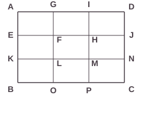
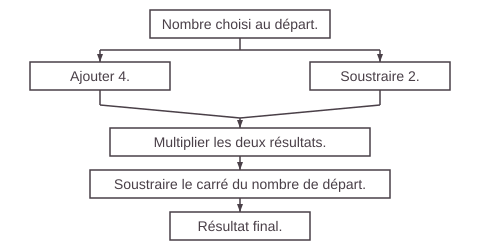
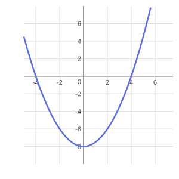
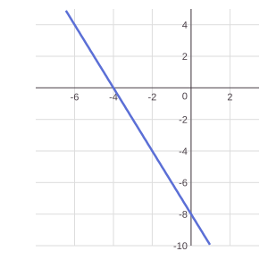
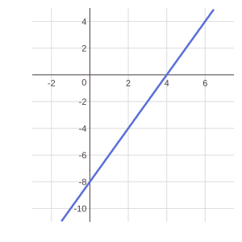

# Annales du brevet 2025 (Polynésie)

> [!abstract] L'essentiel en 30 secondes
> - Le **vrai sujet** de maths du brevet 2025 de Polynésie (série générale, référence 25GENMATPO1) : mêmes textes, mêmes valeurs, mêmes questions.
> - 5 exercices indépendants, 2 h, 100 points : Ex. 1 (20 pts), Ex. 2 (22 pts), Ex. 3 QCM (20 pts), Ex. 4 (20 pts), Ex. 5 algorithmique (18 pts).
> - Toutes les réponses doivent être justifiées, sauf indication contraire. Laisse une trace de ta recherche même si tu n'as pas fini.
> - Cherche d'abord sans regarder les corrigés (cachés par défaut).

## Le cours

Les **énoncés** sont repris à l'identique du sujet officiel (DNB, session 2025, © ministère de l'Éducation nationale). Les **figures** sont refaites pour le site (mêmes données, dessin simplifié) et les **corrigés** sont écrits pour t'expliquer la méthode : ils ne sont pas le barème officiel.

| Exercice | Thème | Chapitres à revoir |
|---|---|---|
| 1 | Tableur, statistiques, pourcentages | 09 Statistiques, 06 Proportionnalité et pourcentages |
| 2 | Pythagore, trigonométrie, Thalès | 11, 13, 12 |
| 3 | QCM | 02, 03, 04, 14 |
| 4 | Programme de calcul, fonctions | 04, 05, 08 |
| 5 | Probabilités, Scratch | 10, 17 |

> [!tip] À retenir avant de commencer
> - **Tableur** : une formule commence par $=$ ; **=SOMME(B2:G2)** additionne les cellules de B2 à G2.
> - **Moyenne avec effectifs** : on multiplie chaque valeur par son effectif, on additionne, puis on divise par l'effectif total.
> - **Augmenter de $t$ %** revient à multiplier par $1 + \dfrac{t}{100}$ (hausse de 10 % : $\times 1{,}1$).
> - **Pythagore** : dans un triangle rectangle, $\text{hypoténuse}^2 = \text{côté}^2 + \text{côté}^2$. **Sinus** $= \dfrac{\text{opposé}}{\text{hypoténuse}}$ ; on retrouve l'angle avec la touche $\sin^{-1}$.
> - **Thalès** : avec deux droites parallèles, les longueurs sont proportionnelles.
> - **Translation** : tout est déplacé de la même façon, la figure ne tourne pas et ne change pas de taille.
> - **Carré** : $(-3)^2 = 9$ mais $-3^2 = -9$.
> - **Dé équilibré** : chaque face a la même probabilité, $P = \dfrac{\text{faces favorables}}{\text{nombre de faces}}$.

```quiz Sujet 2025 Polynésie : échauffement
? Un club compte 50 inscrits. Une hausse de 20 % est prévue. Combien d'inscrits y aura-t-il ?
= 60
> 50 × 1,2 = 60.

? Notes : 10 avec le coefficient 1 et 14 avec le coefficient 3. Quelle est la moyenne ?
= 13
> (10 × 1 + 14 × 3) ÷ 4 = 52 ÷ 4 = 13.

? Que vaut $(-5)^2$ ?
+ $25$
- $-25$
- $-10$
- $10$
> (−5)² = (−5) × (−5) = 25. Un carré est toujours positif.

? Dans un triangle rectangle, le côté opposé à un angle mesure 3 cm et l'hypoténuse 6 cm. Quelle est la mesure de cet angle en degrés ?
= 30
> sin(angle) = 3 ÷ 6 = 0,5, donc l'angle mesure 30°.

? On translate le point (2 ; 1) de 3 carreaux vers la droite et 2 vers le bas. Quelles sont ses nouvelles coordonnées ?
+ $(5\;;\;-1)$
- $(5\;;\;3)$
- $(-1\;;\;3)$
- $(-1\;;\;-1)$
> Vers la droite : x augmente de 3 (2 + 3 = 5). Vers le bas : y diminue de 2 (1 − 2 = −1).

? On lance un dé équilibré à 12 faces. Quelle est la probabilité d'obtenir un multiple de 4 ? (écris une fraction)
= 1/4
= 3/12
= 0,25
> Les multiples de 4 sont 4, 8 et 12 : 3 faces sur 12, soit 1/4.

? $f(x) = 2x - 8$. Quelle est l'image de 5 ?
= 2
> f(5) = 2 × 5 − 8 = 2.

? Quelle est la solution de l'équation $2x + 3 = 11$ ?
= 4
> 2x = 11 − 3 = 8, donc x = 4.
```

## Exercices corrigés

### Exercice 1 (20 points)

> [!question] Exercice 1
> L'association sportive d'un collège propose aux élèves une activité escalade.
> La feuille de calcul ci-dessous obtenue à l'aide d'un tableur indique la répartition par âge des élèves inscrits à l'escalade.
>
> | | A | B | C | D | E | F | G | H |
> |---|---|---|---|---|---|---|---|---|
> | 1 | **Âge** | 10 | 11 | 12 | 13 | 14 | 15 | **Total** |
> | 2 | **Effectif** | 1 | 3 | 8 | 12 | 4 | 2 | |
>
> 1. Quel est le nombre d'élèves âgés de 12 ans inscrits à l'escalade ?
> 2. Calculer le nombre total d'élèves inscrits à l'escalade.
> 3. Quelle formule peut-on saisir dans la cellule H2 pour obtenir le nombre total d'élèves inscrits à l'escalade ?
> 4. Le professeur affirme : « $\dfrac{1}{5}$ des élèves inscrits à l'escalade ont 14 ans ou plus ». A-t-il raison ?
> 5. L'année dernière, la moyenne des âges des élèves inscrits à l'escalade était de 13 ans. La moyenne des âges des élèves inscrits à l'escalade cette année a-t-elle augmenté par rapport à l'année dernière ?
> 6. L'association prévoit une hausse de 10 % des inscriptions à l'escalade l'année prochaine. Déterminer le nombre d'élèves qui seront inscrits à l'escalade l'année prochaine.

> [!success]- Corrigé de l'exercice 1
> **1.** Dans la colonne de l'âge 12 (colonne D), l'effectif est 8. **8 élèves** ont 12 ans.
>
> **2.** On additionne tous les effectifs : $1 + 3 + 8 + 12 + 4 + 2 = \mathbf{30}$ élèves.
>
> **3.** Dans la cellule H2, on peut saisir **=SOMME(B2:G2)** (ou **=B2+C2+D2+E2+F2+G2**). Une formule commence toujours par le signe =.
>
> **4.** Les élèves de 14 ans ou plus sont les 14 ans et les 15 ans : $4 + 2 = 6$ élèves sur 30.
> $\dfrac{6}{30} = \dfrac{1}{5}$. **Le professeur a raison.**
>
> **5.** Moyenne des âges de cette année : on multiplie chaque âge par son effectif, on additionne, puis on divise par l'effectif total.
> $\dfrac{10 \times 1 + 11 \times 3 + 12 \times 8 + 13 \times 12 + 14 \times 4 + 15 \times 2}{30} = \dfrac{10 + 33 + 96 + 156 + 56 + 30}{30} = \dfrac{381}{30} = 12{,}7$ ans.
> Comme $12{,}7 < 13$, la moyenne **n'a pas augmenté** : elle a diminué.
>
> **6.** Une hausse de 10 % revient à multiplier par $1 + \dfrac{10}{100} = 1{,}1$ :
> $30 \times 1{,}1 = \mathbf{33}$ élèves l'année prochaine.

### Exercice 2 (22 points)

> [!question] Exercice 2
> Le jardin botanique d'une ville peut être représenté par le quadrilatère ABCD ci-dessous.
>
> ![Figure de l'exercice 2 : quadrilatère ABCD, avec les segments [AC] et [BD] qui se coupent en E. Angles droits en A, en D et en E](annales-2025/po-ex2-jardin.svg)
>
> On sait que :
> - AB = 500 m, BE = 250 m et DE = 750 m ;
> - les segments [AC] et [BD] se coupent au point E.
>
> *La figure ci-dessus n'est pas à l'échelle.*
>
> 1. Quelle est la longueur du segment [DB] ?
> 2. En raisonnant dans le triangle rectangle ABD, montrer que la longueur du segment [AD], arrondie au mètre, est égale à 866 m.
> 3. **a.** Calculer le sinus de l'angle $\widehat{EAB}$.
>    **b.** En déduire la mesure en degrés de l'angle $\widehat{EAB}$.
> 4. **a.** Montrer que les droites (AB) et (DC) sont parallèles.
>    **b.** Montrer que la longueur du segment [CD] est égale à 1 500 m.
> 5. Un piéton fait le tour du jardin botanique en marchant à la vitesse moyenne de $1{,}1$ m/s.
>    Il lit sur son plan que la longueur du segment [BC] est environ égale à 1 323 m.
>    Le temps mis par le piéton pour faire le tour du jardin botanique est-il inférieur à une heure ?

> [!success]- Corrigé de l'exercice 2
> **1.** E est sur le segment [DB] : $DB = DE + EB = 750 + 250 = \mathbf{1\,000}$ m.
>
> **2.** Le triangle ABD est rectangle en A (voir la figure). D'après le **théorème de Pythagore**, l'hypoténuse est [BD] :
> $AD^2 = BD^2 - AB^2 = 1\,000^2 - 500^2 = 1\,000\,000 - 250\,000 = 750\,000$.
> $AD = \sqrt{750\,000} \approx 866{,}03$, soit **866 m** au mètre près. ✓
>
> **3. a.** Le triangle ABE est rectangle en E (les diagonales sont perpendiculaires sur la figure). [AB] est l'hypoténuse, [BE] est le côté **opposé** à l'angle $\widehat{EAB}$ :
> $\sin(\widehat{EAB}) = \dfrac{BE}{AB} = \dfrac{250}{500} = \mathbf{0{,}5}$.
>
> **b.** On cherche l'angle dont le sinus vaut $0{,}5$ : $\widehat{EAB} = \sin^{-1}(0{,}5) = \mathbf{30°}$ (touche « arcsin » ou $\sin^{-1}$ de la calculatrice).
>
> **4. a.** Le triangle ABD est rectangle en A : $(AB) \perp (AD)$. Le triangle ADC est rectangle en D (figure) : $(DC) \perp (AD)$. Deux droites perpendiculaires à une même droite sont parallèles : **(AB) // (DC)**. ✓
>
> **b.** Les droites (AC) et (BD) se coupent en E et (AB) // (DC) : d'après le **théorème de Thalès**,
> $\dfrac{EB}{ED} = \dfrac{EA}{EC} = \dfrac{AB}{DC}$, soit $\dfrac{250}{750} = \dfrac{500}{CD}$.
> $CD = \dfrac{750 \times 500}{250} = \mathbf{1\,500}$ m. ✓
>
> **5.** Le tour du jardin est le périmètre du quadrilatère :
> $P = AB + BC + CD + DA = 500 + 1\,323 + 1\,500 + 866 = 4\,189$ m.
> Temps = distance ÷ vitesse : $\dfrac{4\,189}{1{,}1} \approx 3\,808$ s, soit environ $63{,}5$ min (un peu plus de 1 h 03 min).
> *Autre méthode :* en 1 h $= 3\,600$ s, le piéton parcourt $1{,}1 \times 3\,600 = 3\,960$ m, ce qui est moins que $4\,189$ m.
> **Non**, le temps n'est pas inférieur à une heure.

### Exercice 3 (20 points) : QCM

> [!question] Exercice 3 : QCM
> Cet exercice est un questionnaire à choix multiple (QCM).
> Pour chaque question, quatre réponses sont proposées. **Une seule réponse est exacte.**
> **Recopier sur la copie** le numéro de la question **et** la réponse choisie. Aucune justification n'est demandée.
>
> | Questions | Réponse A | Réponse B | Réponse C | Réponse D |
> |---|---|---|---|---|
> | **1.** $(-3)^2$ est égal à | $-9$ | $-6$ | $6$ | $9$ |
> | **2.** La décomposition en produit de facteurs premiers du nombre 360 est | $2^3 \times 9 \times 5$ | $8 \times 3^2 \times 5$ | $2^3 \times 3^2 \times 7$ | $2^3 \times 3^2 \times 5$ |
> | **3.** Un rectangle d'aire 135 cm² a pour largeur 3 cm. Combien mesure sa longueur ? | 15 cm | 45 cm | 132 cm | 405 cm |
> | **4.** Quelle expression littérale correspond à la longueur du segment [BG] ? *(figure ci-dessous)* | $3x^2$ | $2x^2 + 3$ | $5x$ | $2x + 3$ |
> | **5.** Le rectangle ADCB est partagé en neuf rectangles identiques. L'image du rectangle GFHI par la translation qui transforme D en M est le rectangle *(figure ci-dessous)* | EKLF | HMNJ | KBOL | MPCN |
>
> **Figure de la question 4**
>
> ![Figure de la question 4 : segment [BG] avec les points B, D, E, G ; BD = DE = x et EG = 3](annales-2025/po-ex3-q4-segment.svg)
>
> **Figure de la question 5**
>
> 

> [!success]- Corrigé de l'exercice 3
> **Question 1 : réponse D.** $(-3)^2 = (-3) \times (-3) = \mathbf{9}$. Le carré d'un nombre est toujours positif. (Ne confonds pas avec $-3^2 = -9$, où le carré ne porte que sur le 3.)
>
> **Question 2 : réponse D.** $360 = 2 \times 180 = 2 \times 2 \times 90 = 2 \times 2 \times 2 \times 45 = 2^3 \times 3 \times 3 \times 5$, soit $\mathbf{2^3 \times 3^2 \times 5}$. Dans la A, 9 n'est pas premier ; dans la B, 8 n'est pas premier ; la C donne $8 \times 9 \times 7 = 504$.
>
> **Question 3 : réponse B.** Aire $=$ longueur $\times$ largeur, donc longueur $= \dfrac{135}{3} = \mathbf{45}$ cm.
>
> **Question 4 : réponse D.** Les petits traits sur la figure montrent que $BD = DE = x$. Donc $BE = x + x = 2x$ et $BG = BE + EG = \mathbf{2x + 3}$. (Pas de $x^2$ : on additionne des longueurs.)
>
> **Question 5 : réponse C.** Mets chaque rectangle dans le quadrillage (colonnes de 0 à 3 de gauche à droite, lignes de 0 à 3 de haut en bas). D est en $(3\,;\,0)$ et M en $(2\,;\,2)$ : la translation déplace de 1 carreau vers la gauche et de 2 carreaux vers le bas. Le rectangle GFHI (ses sommets sont G, F, H et I) est déplacé de la même façon : G $\to$ K, F $\to$ B, H $\to$ O, I $\to$ L. L'image est donc le rectangle **KBOL**.

```quiz Sujet 2025 Polynésie : exercice 3 (QCM)
? Question 1. $(-3)^2$ est égal à
+ $9$
- $-9$
- $-6$
- $6$
> $(-3)^2 = (-3) \times (-3) = 9$.

? Question 2. La décomposition en produit de facteurs premiers du nombre 360 est
+ $2^3 \times 3^2 \times 5$
- $2^3 \times 9 \times 5$
- $8 \times 3^2 \times 5$
- $2^3 \times 3^2 \times 7$
> 360 = 2 × 2 × 2 × 3 × 3 × 5. Dans les autres propositions, il y a 8 ou 9 (non premiers), ou un 7 en trop.

? Question 3. Un rectangle d'aire 135 cm² a pour largeur 3 cm. Combien mesure sa longueur ?
+ 45 cm
- 15 cm
- 132 cm
- 405 cm
> Longueur = aire ÷ largeur = 135 ÷ 3 = 45 cm.

? Question 4. Sur la figure, BD = DE = x et EG = 3. Quelle expression littérale correspond à la longueur du segment [BG] ?
+ $2x + 3$
- $3x^2$
- $2x^2 + 3$
- $5x$
> BG = BD + DE + EG = x + x + 3 = 2x + 3.

? Question 5. L'image du rectangle GFHI par la translation qui transforme D en M est le rectangle
+ KBOL
- EKLF
- HMNJ
- MPCN
> D → M : 1 carreau vers la gauche et 2 vers le bas. G → K, F → B, H → O, I → L.
```

### Exercice 4 (20 points)

> [!question] Exercice 4
> On considère le programme de calcul suivant.
>
> 
>
> 1. Montrer que si on choisit 5 comme nombre de départ, le résultat du programme est 2.
> 2. On choisit $x$ comme nombre de départ.
>    **a.** Parmi les expressions suivantes, quelle est celle qui permet d'exprimer le résultat de ce programme de calcul en fonction de $x$ ? Aucune justification n'est attendue.
>
> | Expression A | Expression B | Expression C | Expression D |
> |---|---|---|---|
> | $x + 4 \times x - 2 - x^2$ | $x + 4 \times x - 2 - 2x$ | $(x+4) \times (x-2) - x^2$ | $(x+4) \times (x-2) - 2x$ |
>
>    **b.** Montrer que le résultat du programme de calcul peut s'écrire sous la forme $2x - 8$.
> 3. On appelle $f$ la fonction définie par $f(x) = 2x - 8$. Voici trois représentations graphiques :
>
> **Représentation n°1**
>
> 
>
> **Représentation n°2**
>
> 
>
> **Représentation n°3**
>
> 
>
>    **a.** La représentation graphique de la fonction $f$ est la représentation n°3. Expliquer pourquoi les représentations n°1 et n°2 ne conviennent pas.
>    **b.** Déterminer l'image de 4 par la fonction $f$.
> 4. Quel nombre de départ faut-il choisir pour que le résultat du programme de calcul soit égal à 100 ?

> [!success]- Corrigé de l'exercice 4
> **1.** Départ : $5$. À gauche : $5 + 4 = 9$. À droite : $5 - 2 = 3$. On multiplie : $9 \times 3 = 27$. On soustrait le carré du nombre de départ : $27 - 5^2 = 27 - 25 = \mathbf{2}$. ✓
>
> **2. a.** **Expression C** : $(x+4) \times (x-2) - x^2$. Il faut des parenthèses pour que « ajouter 4 » et « soustraire 2 » portent sur le nombre $x$ avant de multiplier, et on enlève le carré $x^2$ (pas $2x$).
>
> **b.** On développe : $(x+4)(x-2) - x^2 = x^2 - 2x + 4x - 8 - x^2 = \mathbf{2x - 8}$. ✓
>
> **3. a.** $f(x) = 2x - 8$ est une **fonction affine** : sa représentation est une **droite**. La représentation n°1 est une courbe (une parabole), ce n'est pas une droite : elle ne convient pas. De plus, le coefficient directeur est $2 > 0$ : la droite doit **monter** quand $x$ augmente. La représentation n°2 descend : elle ne convient pas non plus.
>
> **b.** $f(4) = 2 \times 4 - 8 = 0$. L'image de 4 est **0**. (On le voit sur le graphique n°3 : la droite coupe l'axe des abscisses en 4.)
>
> **4.** Le résultat du programme est $2x - 8$. On résout $2x - 8 = 100$ :
> $2x = 108$, donc $x = \dfrac{108}{2} = \mathbf{54}$.
> *Vérification :* $(54+4) \times (54-2) - 54^2 = 58 \times 52 - 2\,916 = 3\,016 - 2\,916 = 100$. ✓

### Exercice 5 (18 points) : algorithmique

> [!question] Exercice 5
> **Partie A**
>
> Tom a acheté un dé équilibré à 12 faces numérotées de 1 à 12.
> Il lance ce dé et s'intéresse au résultat qui apparaît sur la face du dessus.
> Sur la photo de ce dé, le résultat obtenu est 3.
>
> 1. Expliquer pourquoi la probabilité d'obtenir le nombre 4 est égale à $\dfrac{1}{12}$.
> 2. Quelle est la probabilité que le résultat obtenu soit un nombre pair ?
> 3. Tom pense que la probabilité d'obtenir un multiple de 3 est supérieure à $0{,}3$. A-t-il raison ?
>
> **Partie B**
>
> Tom souhaite maintenant simuler le lancer de deux dés équilibrés à 12 faces numérotées de 1 à 12.
> Le bloc « Lancer » simule le lancer des deux dés et calcule la somme obtenue.
> Par exemple, si le résultat du dé n°1 est égal à 3 et que le résultat du dé n°2 est égal à 5 alors la somme sera égale à 8.
> Voici le programme de Tom.
>
> **Programme**
> - quand 🏴 est cliqué
> - Lancer
> - si (*Résultat* > 6) alors : dire « Gagné ! » pendant 2 secondes
> - sinon : dire « Perdu ! » pendant 2 secondes
>
> **Bloc « Lancer »**
> - 1 : définir Lancer
> - 2 : mettre *Dé 1* à (nombre aléatoire entre 1 et **...**)
> - 3 : mettre *Dé 2* à (nombre aléatoire entre **...** et 12)
> - 4 : mettre *Résultat* à (**...** + **...**)
>
> *On rappelle que l'instruction « nombre aléatoire entre 1 et 4 » renvoie au hasard un nombre parmi 1, 2, 3 ou 4.*
>
> 1. Recopier les lignes 2, 3 et 4 du bloc « Lancer » en les complétant.
> 2. Si le résultat du dé n°1 est égal à 8 et le résultat du dé n°2 est égal à 3, qu'affichera le programme ? Justifier.

> [!success]- Corrigé de l'exercice 5
> **Partie A**
>
> **1.** Le dé est équilibré : les 12 faces ont la même probabilité de sortir. Il y a 12 issues possibles et une seule face porte le 4 : $P(4) = \dfrac{1}{12}$. ✓
>
> **2.** Les nombres pairs de 1 à 12 sont 2, 4, 6, 8, 10, 12 : 6 issues favorables sur 12. $P(\text{pair}) = \dfrac{6}{12} = \dfrac{1}{2} = \mathbf{0{,}5}$.
>
> **3.** Les multiples de 3 sont 3, 6, 9, 12 : 4 issues sur 12. $P = \dfrac{4}{12} = \dfrac{1}{3} \approx 0{,}333$. Comme $0{,}333\ldots > 0{,}3$, **Tom a raison**.
>
> **Partie B**
>
> **1.** Chaque dé a 12 faces, donc un nombre aléatoire entre 1 et 12. Le résultat est la somme des deux dés :
> - ligne 2 : mettre *Dé 1* à **nombre aléatoire entre 1 et 12**
> - ligne 3 : mettre *Dé 2* à **nombre aléatoire entre 1 et 12**
> - ligne 4 : mettre *Résultat* à **Dé 1 + Dé 2**
>
> **2.** Avec Dé 1 $= 8$ et Dé 2 $= 3$ : *Résultat* $= 8 + 3 = 11$. Comme $11 > 6$, la condition « *Résultat* > 6 » est vraie : le programme affiche **« Gagné ! »** pendant 2 secondes.

### Petits exercices pour s'entraîner

> [!question] Petit exercice A
> Un club de sport compte 40 inscrits. L'an prochain, il prévoit une hausse de 15 %. Combien d'inscrits sont prévus ?

> [!success]- Corrigé du petit exercice A
> Hausse de 15 % : on multiplie par $1{,}15$. $40 \times 1{,}15 = \mathbf{46}$ inscrits.

> [!question] Petit exercice B
> Le triangle ABC est rectangle en A, avec AB = 6 cm et BC = 10 cm. Calculer AC, puis $\cos(\widehat{ABC})$.

> [!success]- Corrigé du petit exercice B
> Pythagore : $AC^2 = BC^2 - AB^2 = 100 - 36 = 64$, donc $AC = \mathbf{8}$ cm.
> Dans le triangle ABC, [AB] est le côté adjacent à l'angle $\widehat{ABC}$ et [BC] l'hypoténuse : $\cos(\widehat{ABC}) = \dfrac{6}{10} = \mathbf{0{,}6}$.

## Voir aussi

[[19 - Annales du brevet 2025 (série générale)]] · [[18 - QCM de brevet (sujets récents)]] · [[10 - Probabilités]] · [[17 - Algorithmique et Scratch]]
