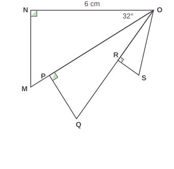
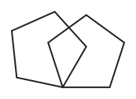
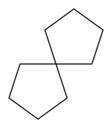
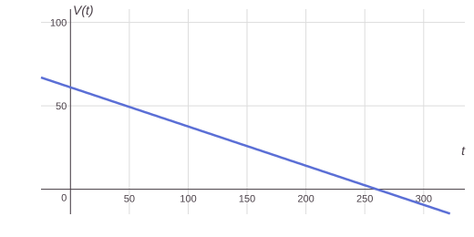

# Annales du brevet 2024 (Polynésie)

> [!abstract] L'essentiel en 30 secondes
> - Le **vrai sujet** de maths du brevet 2024 de Polynésie (série générale, référence 24GENMATPO3) : mêmes textes, mêmes valeurs, mêmes questions.
> - 5 exercices indépendants, 2 h, 100 points : Ex. 1 (21 pts), Ex. 2 (20 pts), Ex. 3 (17 pts), Ex. 4 (19 pts), Ex. 5 (23 pts).
> - Une annexe est à rendre avec la copie (exercice 4) : elle est reprise dans l'exercice, sous forme de questions.
> - Cherche d'abord sans regarder les corrigés (cachés par défaut).

## Le cours

Les **énoncés** sont repris à l'identique du sujet officiel (DNB, session 2024, © ministère de l'Éducation nationale). Les **figures** sont refaites pour le site (mêmes données, dessin simplifié) et les **corrigés** sont écrits pour t'expliquer la méthode : ils ne sont pas le barème officiel.

| Exercice | Thème | Chapitres à revoir |
|---|---|---|
| 1 | Questions indépendantes | 02, 03, 05, 07, 12 |
| 2 | Statistiques, tableur, probabilités | 09, 10 |
| 3 | Trigonométrie, agrandissement | 13, 14 |
| 4 | Angles, Scratch, transformations | 14, 17 |
| 5 | Volume du cylindre, fonction affine | 15, 08 |

> [!tip] À retenir avant de commencer
> - **Divisible par 21** : il faut un 3 **et** un 7 dans la décomposition en facteurs premiers.
> - **Écriture scientifique** : $a \times 10^n$ avec $1 \leq a < 10$ ; pour un petit nombre, l'exposant $n$ est négatif.
> - **Vitesse** : 1 km/min $= 1\,000$ m $\div$ 60 s ; pour passer de km/h à m/s, on divise par 3,6.
> - **Équation produit nul** : $A \times B = 0$ si $A = 0$ ou $B = 0$.
> - **Thalès** : avec (AB) // (ED), $\dfrac{CD}{CB} = \dfrac{DE}{AB}$.
> - **Médiane** : valeur du milieu ; **étendue** : plus grande valeur $-$ plus petite.
> - **Agrandissement de rapport $k$** : longueurs $\times k$, aires $\times k^2$.
> - **Polygone régulier à $n$ côtés** : on tourne de $\dfrac{360}{n}$ degrés (72° pour un pentagone).
> - **Volume d'un cylindre** $= \pi \times r^2 \times h$.

```quiz Sujet 2024 Polynésie : échauffement
? Quelle est l'écriture scientifique de 0,00035 ?
+ $3{,}5 \times 10^{-4}$
- $3{,}5 \times 10^{4}$
- $35 \times 10^{-5}$
- $0{,}35 \times 10^{-3}$
> On décale la virgule de 4 rangs vers la droite : 3,5 × 10⁻⁴. Les autres écritures ne respectent pas 1 ≤ a < 10 ou donnent un autre nombre.

? Convertis 90 km/h en m/s. (écris le nombre seul)
= 25
> 90 ÷ 3,6 = 25 m/s.

? Quelles sont les solutions de $(x-2)(x+5) = 0$ ?
+ $2$ et $-5$
- $-2$ et $5$
- $2$ et $5$
- $-2$ et $-5$
> x − 2 = 0 donne x = 2 ; x + 5 = 0 donne x = −5.

? Quelle est l'étendue de la série 3 ; 5 ; 9 ; 12 ?
= 9
> 12 − 3 = 9.

? Dans un pentagone régulier, de combien de degrés tourne-t-on à chaque sommet quand on trace le contour ? (écris le nombre seul)
= 72
> 360 ÷ 5 = 72°.

? Quel est le volume d'un cylindre de rayon 2 cm et de hauteur 5 cm, arrondi au dixième de cm³ ?
= 62,8
> π × 2² × 5 = 20π ≈ 62,8 cm³.

? Un triangle est agrandi avec un rapport 3. Par combien son aire est-elle multipliée ? (écris le nombre seul)
= 9
> Les aires sont multipliées par k² = 3² = 9.

? Quelle transformation est équivalente à une rotation de 180° autour d'un point O ?
+ La symétrie centrale de centre O
- La symétrie axiale
- Une translation
- Une homothétie de rapport 2
> La symétrie centrale de centre O envoie chaque point M sur M' tel que O soit le milieu de [MM'], ce qui revient à tourner de 180° autour de O.
```

## Exercices corrigés

### Exercice 1 (21 points)

> [!question] Exercice 1
> Dans cet exercice, toutes les questions sont indépendantes.
>
> 1. On a décomposé ci-dessous cinq nombres en produits de facteurs premiers. Parmi ces nombres, lesquels sont divisibles par 21 ?
>
> | Nombre 1 | Nombre 2 | Nombre 3 | Nombre 4 | Nombre 5 |
> |---|---|---|---|---|
> | $2^2 \times 11 \times 23$ | $2^4 \times 3^4 \times 11$ | $7^3 \times 13 \times 17$ | $2 \times 3 \times 5 \times 7$ | $2^3 \times 3^2 \times 7$ |
>
> 2. Donner, sans justification, l'écriture scientifique du nombre $0{,}000\,002\,76$.
> 3. La comète Hale-Bopp a atteint la vitesse de 2 640 km/min. Quelle est sa vitesse en m/s ?
> 4. Quelles sont les solutions de l'équation $(2x - 7)(3x + 1) = 0$ ?
> 5. On considère la fonction $f$ définie par $f(x) = 5x^2 + 2$. Quelle est l'image de $-3$ par la fonction $f$ ?
> 6. Sur la figure ci-dessous (qui n'est pas à l'échelle) :
>    - les points A, E et C sont alignés ;
>    - les points B, D et C sont alignés ;
>    - les droites (AB) et (ED) sont parallèles ;
>    - AB = 5 cm, BD = 1 cm, CD = 3 cm.
>
>    Calculer DE.
>
> ![Figure de la question 6 : triangle ABC avec D sur [BC] et E sur [AC], (ED) parallèle à (AB)](annales-2024/po-ex1-q6-triangle.svg)

> [!success]- Corrigé de l'exercice 1
> **1.** $21 = 3 \times 7$. Un nombre est divisible par 21 si sa décomposition contient **à la fois un 3 et un 7**.
> - Nombre 1 : pas de 3, pas de 7. ✗
> - Nombre 2 : il y a des 3 mais pas de 7. ✗
> - Nombre 3 : il y a des 7 mais pas de 3. ✗
> - Nombre 4 : $2 \times 3 \times 5 \times 7$ contient 3 et 7. ✓
> - Nombre 5 : $2^3 \times 3^2 \times 7$ contient 3 et 7. ✓
>
> Les nombres **4 et 5** sont divisibles par 21.
>
> **2.** On déplace la virgule pour avoir un seul chiffre non nul avant la virgule : $0{,}000\,002\,76 = \mathbf{2{,}76 \times 10^{-6}}$ (la virgule a reculé de 6 rangs).
>
> **3.** $2\,640$ km/min $= 2\,640\,000$ m par minute. Or 1 min $= 60$ s :
> $\dfrac{2\,640\,000}{60} = \mathbf{44\,000}$ m/s.
>
> **4.** Un produit de facteurs est nul si **l'un des facteurs est nul** :
> - $2x - 7 = 0 \Rightarrow 2x = 7 \Rightarrow x = \dfrac{7}{2} = 3{,}5$
> - $3x + 1 = 0 \Rightarrow 3x = -1 \Rightarrow x = -\dfrac{1}{3}$
>
> Les solutions sont $\mathbf{3{,}5}$ et $\mathbf{-\dfrac{1}{3}}$.
>
> **5.** $f(-3) = 5 \times (-3)^2 + 2 = 5 \times 9 + 2 = 45 + 2 = \mathbf{47}$. (Le carré se calcule avant le produit.)
>
> **6.** Les points C, D, B et C, E, A sont alignés et (AB) // (ED) : d'après le **théorème de Thalès**,
> $\dfrac{CD}{CB} = \dfrac{CE}{CA} = \dfrac{DE}{AB}$. On a $CB = CD + DB = 3 + 1 = 4$ cm, donc $\dfrac{3}{4} = \dfrac{DE}{5}$.
> $DE = \dfrac{3 \times 5}{4} = \dfrac{15}{4} = \mathbf{3{,}75}$ cm.

```quiz Sujet 2024 Polynésie : exercice 1
? Question 1. Un nombre est divisible par 21 s'il contient dans sa décomposition en facteurs premiers à la fois 3 et 7. Lesquels de ces nombres sont divisibles par 21 ?
+ Nombre 4 ($2 \times 3 \times 5 \times 7$) et nombre 5 ($2^3 \times 3^2 \times 7$)
- Nombre 2 ($2^4 \times 3^4 \times 11$) et nombre 3 ($7^3 \times 13 \times 17$)
- Seulement le nombre 4
- Nombre 1 ($2^2 \times 11 \times 23$) et nombre 5
> 21 = 3 × 7 : il faut un 3 et un 7. Seuls les nombres 4 et 5 ont les deux.

? Question 3. La comète Hale-Bopp a atteint la vitesse de 2 640 km/min. Quelle est sa vitesse en m/s ? (écris le nombre seul)
= 44000
> 2 640 km = 2 640 000 m et 1 min = 60 s : 2 640 000 ÷ 60 = 44 000 m/s.

? Question 5. $f(x) = 5x^2 + 2$. Quelle est l'image de $-3$ par la fonction $f$ ?
= 47
> f(−3) = 5 × (−3)² + 2 = 5 × 9 + 2 = 47.

? Question 6. Avec AB = 5 cm, BD = 1 cm, CD = 3 cm et (AB) // (ED), combien mesure DE (en cm) ?
= 3,75
> Thalès : CD/CB = DE/AB, avec CB = 4 : 3/4 = DE/5, donc DE = 15/4 = 3,75 cm.
```

### Exercice 2 (20 points)

> [!question] Exercice 2
> On a relevé dans une feuille de calcul les températures maximales Tmax (en °C) atteintes à Strasbourg le 25 juin de chaque année de 2010 à 2018 (source : *meteociel.fr*).
>
> | | A | B | C | D | E | F | G | H | I | J |
> |---|---|---|---|---|---|---|---|---|---|---|
> | 1 | Année | 2010 | 2011 | 2012 | 2013 | 2014 | 2015 | 2016 | 2017 | 2018 |
> | 2 | Tmax | 29 | 23,1 | 22,6 | 17,4 | 23,4 | 25,7 | 25,2 | 26 | 24 |
> | 3 | | | | | | | | | | |
> | 4 | Moyenne | | | | | | | | | |
> | 5 | Médiane | 24 | | | | | | | | |
> | 6 | Étendue | 11,6 | | | | | | | | |
>
> 1. On a oublié de calculer la moyenne de cette série. Quelle formule peut-on saisir dans la cellule B4 pour que ce calcul soit effectué ?
> 2. Donner, sans détailler les calculs, une valeur approchée au degré Celsius près de la moyenne de la série.
> 3. Donner une interprétation de la médiane de cette série.
> 4. Pour cette question seulement, on considère la série des températures maximales atteintes à Strasbourg le 25 juin de chaque année de 2010 à 2019. On sait que l'étendue des températures de cette nouvelle série est égale à $18{,}5$ °C. Déterminer la température maximale atteinte à Strasbourg le 25 juin 2019.
>
> Les questions suivantes portent sur la série des températures maximales atteintes à Strasbourg le 25 juin de chaque année de 2010 à 2018.
>
> 5. On crée 9 fiches, une par année, sur lesquelles figure la température maximale atteinte le 25 juin de l'année. On prend une fiche au hasard. Chacune des fiches a la même probabilité d'être tirée.
>    **a.** Quelle est la probabilité que la température écrite sur cette fiche soit égale à 26 °C ?
>    **b.** Quelle est la probabilité que la température écrite sur cette fiche soit inférieure ou égale à 24 °C ?
>    **c.** A-t-on raison de dire que l'on a plus de 40 % de chance de prendre une fiche sur laquelle la température est supérieure à 25 °C ?

> [!success]- Corrigé de l'exercice 2
> **1.** Les températures sont dans les cellules B2 à J2. On saisit **=MOYENNE(B2:J2)**.
>
> **2.** La somme vaut $29 + 23{,}1 + 22{,}6 + 17{,}4 + 23{,}4 + 25{,}7 + 25{,}2 + 26 + 24 = 216{,}4$. Moyenne : $\dfrac{216{,}4}{9} \approx 24{,}04$, soit environ **24 °C**.
>
> **3.** La médiane vaut 24 °C : **au moins la moitié des années, le 25 juin, la température maximale a été inférieure ou égale à 24 °C, et au moins la moitié des années elle a été supérieure ou égale à 24 °C.**
>
> **4.** L'étendue est la différence entre la plus grande et la plus petite valeur. Sur 2010 à 2018, elle valait $29 - 17{,}4 = 11{,}6$. Avec l'année 2019, elle passe à $18{,}5$ : la valeur de 2019 est donc **un nouveau maximum ou un nouveau minimum**.
> - Nouveau maximum : $T - 17{,}4 = 18{,}5$, donc $T = 17{,}4 + 18{,}5 = \mathbf{35{,}9}$ °C.
> - Nouveau minimum : $29 - T = 18{,}5$, donc $T = 10{,}5$ °C. Un maximum de seulement 10,5 °C un 25 juin à Strasbourg n'est pas réaliste.
>
> La température maximale du 25 juin 2019 est donc **35,9 °C** (la valeur 10,5 °C est mathématiquement possible mais peu plausible).
>
> **5. a.** Une seule fiche affiche 26 °C (celle de 2017) : $P = \dfrac{1}{9}$.
>
> **b.** Les températures inférieures ou égales à 24 °C sont : $23{,}1$ ; $22{,}6$ ; $17{,}4$ ; $23{,}4$ ; $24$. Il y en a 5 sur 9 : $P = \dfrac{5}{9}$.
>
> **c.** Les températures supérieures à 25 °C sont : $29$ ; $25{,}7$ ; $25{,}2$ ; $26$. Il y en a 4 sur 9 : $\dfrac{4}{9} \approx 0{,}444$, soit environ $44{,}4$ %. Comme $44{,}4\ \% > 40\ \%$, **oui, on a raison**.

### Exercice 3 (17 points)

> [!question] Exercice 3
> Sur la figure ci-dessous, qui n'est pas à l'échelle,
> - le triangle ONM est rectangle en N,
> - le triangle OPQ est rectangle en P,
> - le triangle ORS est rectangle en R,
> - $ON = 6$ cm et $\widehat{MON} = 32°$.
> - P est un point du segment [OM] et R est un point du segment [OQ].
>
> 
>
> 1. Calculer la mesure de la longueur MN. On donnera une valeur approchée au millimètre près.
> 2. On donne PQ = $2{,}5$ cm et OQ = $6{,}5$ cm. Montrer que OP = 6 cm.
> 3. Montrer que les triangles ONM et OPQ ne sont pas des triangles égaux.
> 4. Sachant que le triangle OPQ est un agrandissement du triangle ORS et que OS = $3{,}25$ cm, calculer l'aire du triangle ORS.

> [!success]- Corrigé de l'exercice 3
> **1.** Dans le triangle ONM rectangle en N, par rapport à l'angle $\widehat{MON}$ de $32°$, [MN] est le côté **opposé** et [ON] le côté **adjacent** : on utilise la tangente.
> $\tan(32°) = \dfrac{MN}{ON}$, donc $MN = 6 \times \tan(32°) \approx 3{,}749$ cm, soit **3,7 cm** au millimètre près.
>
> **2.** Le triangle OPQ est rectangle en P, donc d'après le **théorème de Pythagore** : $OQ^2 = OP^2 + PQ^2$.
> $OP^2 = OQ^2 - PQ^2 = 6{,}5^2 - 2{,}5^2 = 42{,}25 - 6{,}25 = 36$, donc $OP = \sqrt{36} = \mathbf{6}$ cm. ✓
>
> **3.** Deux triangles égaux ont leurs côtés de même longueur. Les deux triangles sont rectangles et ont un côté de l'angle droit de 6 cm ($ON = OP = 6$ cm). Leur autre côté de l'angle droit mesure $MN \approx 3{,}7$ cm dans le premier et $PQ = 2{,}5$ cm dans le second. Comme $3{,}7 \neq 2{,}5$, **les triangles ONM et OPQ ne sont pas égaux**.
>
> **4.** Dans le triangle OPQ rectangle en P, l'hypoténuse est $OQ = 6{,}5$ cm ; dans le triangle ORS rectangle en R, l'hypoténuse est $OS = 3{,}25$ cm. Le coefficient d'agrandissement de ORS à OPQ est donc $k = \dfrac{6{,}5}{3{,}25} = 2$.
> Les côtés de ORS sont deux fois plus petits : $OR = \dfrac{OP}{2} = 3$ cm et $RS = \dfrac{PQ}{2} = 1{,}25$ cm.
> Aire de ORS $= \dfrac{OR \times RS}{2} = \dfrac{3 \times 1{,}25}{2} = \mathbf{1{,}875}$ cm².
> *Vérification :* l'aire de OPQ est $\dfrac{6 \times 2{,}5}{2} = 7{,}5$ cm² ; les aires sont multipliées par $k^2 = 4$ et $7{,}5 \div 4 = 1{,}875$. ✓

### Exercice 4 (19 points)

> [!question] Exercice 4
> 1. Sur la figure ci-dessous, DEFGH est un pentagone régulier et le point E appartient à la demi-droite $[Dy)$. On admet que tous les angles du pentagone régulier mesurent 108 degrés.
>
> ![Pentagone régulier DEFGH, avec la demi-droite [Dy) prolongeant [DE] et l'angle FEy marqué](annales-2024/po-ex4-pentagone.svg)
>
>    Justifier que l'angle $\widehat{FEy}$ mesure 72 degrés.
>
> 2. Dans la suite de cet exercice, aucune justification n'est attendue.
>    **a.** Compléter le bloc « pentagone » en ANNEXE, à rendre avec la copie, pour obtenir un pentagone régulier. La variable « longueur » permet de modifier la longueur des côtés du pentagone.
>
>    *Bloc « pentagone » de l'annexe :*
>    - définir pentagone
>    - stylo en position d'écriture
>    - répéter (**...**) fois :
>      - avancer de (longueur) pas
>      - tourner ↺ de (**...**) degrés
>    - relever le stylo
>
>    **b.** Camille, Lou et Zoé ont chacun codé un programme qui trace un pentagone et son image par l'une des transformations suivantes : translation, symétrie centrale, rotation.
>
> | Ligne | Programme de Camille | Programme de Lou | Programme de Zoé |
> |---|---|---|---|
> | 1 | quand 🏴 est cliqué | quand 🏴 est cliqué | quand 🏴 est cliqué |
> | 2 | effacer tout | effacer tout | effacer tout |
> | 3 | aller à x : 0 y : 0 | aller à x : 0 y : 0 | aller à x : 0 y : 0 |
> | 4 | s'orienter à 90 | s'orienter à 90 | s'orienter à 90 |
> | 5 | mettre longueur à 60 | mettre longueur à 60 | mettre longueur à 60 |
> | 6 | pentagone | pentagone | pentagone |
> | 7 | avancer de 120 pas | tourner ↺ de 60 degrés | tourner ↺ de 180 degrés |
> | 8 | pentagone | pentagone | pentagone |
>
>    *On rappelle que l'instruction « s'orienter à 90 » signifie que l'on s'oriente vers la droite.*
>
>    Les trois élèves ont effectué une copie d'écran de ce qu'ils ont obtenu sans indiquer ni leur prénom ni le nom de la transformation choisie.
>
> | Copie d'écran 1 | Copie d'écran 2 | Copie d'écran 3 |
> |---|---|---|
> |  |  |  |
>
>    Compléter le tableau en ANNEXE, à rendre avec la copie, en associant le prénom de l'élève au numéro de sa copie d'écran ainsi qu'au nom de la transformation qu'il a choisie.
>
> | Nom de l'élève | Numéro de la copie d'écran | Nom de la transformation |
> |---|---|---|
> | Camille | | |
> | Lou | | |
> | Zoé | | |
>
>    **c.** Sofia souhaite illustrer à l'aide d'un programme l'effet d'une homothétie sur un pentagone. Le tableau en ANNEXE donne, dans le désordre, toutes les instructions utiles pour écrire ce programme. L'ordre d'apparition dans le programme de deux instructions est précisé. Compléter ce tableau sur l'ANNEXE, à rendre avec la copie, en indiquant l'ordre d'apparition de chacune des instructions dans le programme de Sofia.
>
> | Instruction | Ordre d'apparition de l'instruction dans le programme de Sofia |
> |---|---|
> | effacer tout | |
> | s'orienter à 90 | |
> | pentagone | 6<sup>e</sup> |
> | quand 🏴 est cliqué | 1<sup>re</sup> |
> | mettre longueur à 60 | |
> | aller à x : 0 y : 0 | |
> | pentagone | |
> | mettre longueur à (longueur × 1,5) | |

> [!success]- Corrigé de l'exercice 4
> **1.** Les points D, E et y sont alignés : l'angle $\widehat{DEy}$ est un angle plat de $180°$. Il est formé des deux angles adjacents $\widehat{DEF}$ et $\widehat{FEy}$ :
> $\widehat{FEy} = 180° - \widehat{DEF} = 180° - 108° = \mathbf{72°}$. ✓
>
> **2. a.** Un pentagone régulier a **5 côtés égaux**, et on tourne de $72°$ à chaque sommet (c'est l'angle extérieur trouvé à la question 1, aussi égal à $360° \div 5$) :
> - répéter **5** fois : avancer de (longueur) pas, tourner ↺ de **72** degrés.
>
> **b.**
>
> | Nom de l'élève | Numéro de la copie d'écran | Nom de la transformation |
> |---|---|---|
> | Camille | **3** | **translation** |
> | Lou | **1** | **rotation** |
> | Zoé | **2** | **symétrie centrale** |
>
> *Explications :* Camille avance de 120 pas avant de redessiner le même pentagone : il est simplement glissé vers la droite, sans changer d'orientation (translation, copie 3 : deux pentagones côte à côte). Lou tourne de $60°$ autour du point de départ : le second pentagone est tourné autour d'un sommet commun (rotation, copie 1 : les pentagones se chevauchent). Zoé tourne de $180°$ : le second pentagone est « à l'envers » et touche le premier par le point de départ (symétrie centrale de centre ce point, copie 2).
>
> **c.** Une homothétie de centre le point de départ agrandit la figure. Le programme de Sofia dessine un premier pentagone de côté 60, puis un second de côté $60 \times 1{,}5 = 90$ depuis le même point et dans la même direction.
>
> | Instruction | Ordre d'apparition |
> |---|---|
> | quand 🏴 est cliqué | **1<sup>re</sup>** |
> | effacer tout | **2<sup>e</sup>** |
> | aller à x : 0 y : 0 | **3<sup>e</sup>** |
> | s'orienter à 90 | **4<sup>e</sup>** |
> | mettre longueur à 60 | **5<sup>e</sup>** |
> | pentagone (premier) | **6<sup>e</sup>** |
> | mettre longueur à (longueur × 1,5) | **7<sup>e</sup>** |
> | pentagone (second) | **8<sup>e</sup>** |
>
> Le premier « pentagone » est dessiné avant d'agrandir la longueur, le second après.

### Exercice 5 (23 points)

> [!question] Exercice 5
> La piscine du camping « le Rocher » dispose d'un bassin circulaire de forme cylindrique de rayon $3{,}60$ m et de hauteur $1{,}50$ m. En fin de saison, on utilise une pompe dont le débit est de $14{,}1$ m³/h pour vider l'eau de la piscine.
>
> 1. Montrer que le volume du bassin, arrondi au dixième de m³, est $61{,}1$ m³.
> 2. Le bassin est plein. On met en route la pompe. Au bout de 2 heures, quel volume d'eau en m³ reste-t-il à vider ?
>
> On considère la fonction $V : t \mapsto 61{,}1 - 0{,}235\,t$.
>
> 3. **a.** Montrer que l'expression $V(t)$ permet de déterminer le volume d'eau en m³ qu'il reste à vider dans le bassin en fonction de la durée $t$, exprimée en minute, d'utilisation de la pompe.
>    **b.** Calculer le temps nécessaire pour que le volume d'eau restant à vider soit égal à 30 m³. On donnera une valeur approchée à la minute près.
> 4. On a tracé ci-dessous une partie de la représentation graphique de la fonction $V$.
>
> 
>
>    Répondre aux questions suivantes par une lecture graphique.
>    **a.** Déterminer l'antécédent de 40 par la fonction $V$. Interpréter le résultat.
>    **b.** Déterminer le temps nécessaire pour que la pompe vide complètement le bassin.

> [!success]- Corrigé de l'exercice 5
> **1.** Volume d'un cylindre $= \pi \times r^2 \times h = \pi \times 3{,}6^2 \times 1{,}5 = \pi \times 12{,}96 \times 1{,}5 = \pi \times 19{,}44 \approx 61{,}07$ m³, soit **61,1 m³** au dixième près. ✓
>
> **2.** En 2 heures, la pompe évacue $14{,}1 \times 2 = 28{,}2$ m³. Il reste $61{,}1 - 28{,}2 = \mathbf{32{,}9}$ m³ à vider.
>
> **3. a.** Le débit est de $14{,}1$ m³ **par heure**, soit $\dfrac{14{,}1}{60} = 0{,}235$ m³ **par minute**. Au bout de $t$ minutes, la pompe a évacué $0{,}235\,t$ m³ ; il reste donc $V(t) = 61{,}1 - 0{,}235\,t$. ✓
>
> **b.** On résout $V(t) = 30$ :
> $61{,}1 - 0{,}235\,t = 30$
> $0{,}235\,t = 61{,}1 - 30 = 31{,}1$
> $t = \dfrac{31{,}1}{0{,}235} \approx 132{,}3$, soit environ **132 minutes** (2 h 12 min).
>
> **4. a.** On cherche l'abscisse du point de la droite d'ordonnée 40 : on lit $t \approx \mathbf{90}$. *(Par le calcul : $61{,}1 - 0{,}235\,t = 40$ donne $t \approx 89{,}8$.)*
> *Interprétation :* au bout d'environ 90 minutes (1 h 30), il reste 40 m³ d'eau à vider.
>
> **b.** Le bassin est vide quand $V(t) = 0$ : on lit l'abscisse du point où la droite coupe l'axe horizontal, $t \approx \mathbf{260}$ minutes, soit environ 4 h 20 min. *(Par le calcul : $\dfrac{61{,}1}{0{,}235} = 260$.)*

### Petits exercices pour s'entraîner

> [!question] Petit exercice A
> Convertir 108 km/h en m/s.

> [!success]- Corrigé du petit exercice A
> $108 \div 3{,}6 = \mathbf{30}$ m/s. *(Ou : $108\,000$ m en $3\,600$ s, donc $\dfrac{108\,000}{3\,600} = 30$.)*

> [!question] Petit exercice B
> Résoudre l'équation $(3x - 6)(x + 4) = 0$.

> [!success]- Corrigé du petit exercice B
> Un produit est nul si l'un des facteurs est nul :
> - $3x - 6 = 0 \Rightarrow x = 2$
> - $x + 4 = 0 \Rightarrow x = -4$
>
> Les solutions sont $\mathbf{2}$ et $\mathbf{-4}$.

## Voir aussi

[[20 - Annales du brevet 2025 (Polynésie)]] · [[19 - Annales du brevet 2025 (série générale)]] · [[13 - Trigonométrie]] · [[14 - Transformations]] · [[17 - Algorithmique et Scratch]]
