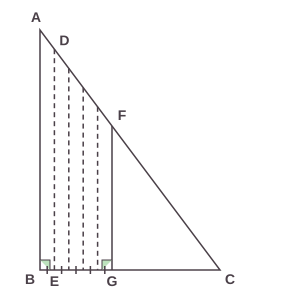
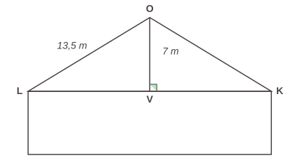
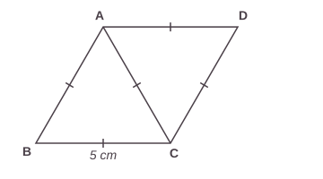
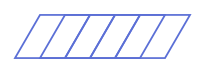
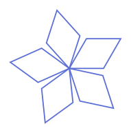
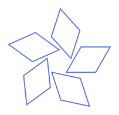

# Annales du brevet 2024 (Métropole, Antilles-Guyane)

> [!abstract] L'essentiel en 30 secondes
> - Le **vrai sujet** de maths du brevet 2024, série générale, référence 24GENMATMEAG3 : mêmes textes, mêmes valeurs, mêmes questions.
> - 5 exercices indépendants de 20 points chacun, 2 h, 100 points.
> - Toutes les réponses doivent être justifiées, sauf indication contraire. Laisse une trace de ta recherche même si tu n'as pas fini.
> - Cherche d'abord sans regarder les corrigés (cachés par défaut).

## Le cours

Les **énoncés** sont repris à l'identique du sujet officiel (DNB, session 2024, © ministère de l'Éducation nationale). Les **figures** sont refaites pour le site (mêmes données, dessin simplifié) et les **corrigés** sont écrits pour t'expliquer la méthode : ils ne sont pas le barème officiel.

| Exercice | Thème | Chapitres à revoir |
|---|---|---|
| 1 | Vrai ou faux | 03, 10, 05, 15, 16 |
| 2 | Pythagore, Thalès, proportionnalité | 11, 12, 06 |
| 3 | Statistiques, pourcentages, trigonométrie | 09, 06, 13 |
| 4 | Fonctions, tableur, factorisation | 07, 04 |
| 5 | Losange, Scratch, rotation | 14, 17 |

> [!tip] À retenir avant de commencer
> - **Facteurs premiers** : tous les facteurs d'une décomposition doivent être premiers (4 ne l'est pas).
> - **Probabilité** $= \dfrac{\text{cas favorables}}{\text{cas possibles}}$ ; on compare des fractions en les écrivant en décimaux.
> - **Équation** : on regroupe les $x$ d'un côté et les nombres de l'autre, puis on divise.
> - **Vitesses** : pour comparer, on convertit dans la même unité (m/s $\times$ 3,6 $=$ km/h).
> - **Thalès** : avec deux droites parallèles, $\dfrac{CG}{CB} = \dfrac{GF}{BA}$ ; **Pythagore** : $\text{hypoténuse}^2 = \text{côté}^2 + \text{côté}^2$.
> - **Proportionnalité** : si le temps est proportionnel à la surface, on utilise un produit en croix.
> - **Pourcentage** : $t$ % de $N$ $= N \times \dfrac{t}{100}$.
> - **Image** d'un nombre par $f$ : on remplace $x$ par ce nombre.
> - **Losange** : 4 côtés égaux ; deux triangles équilatéraux accolés donnent des angles de $60°$ et $120°$.

```quiz Sujet 2024 : échauffement
? Résous l'équation $3x + 4 = x + 10$. (écris le nombre seul)
= 3
> 3x − x = 10 − 4, donc 2x = 6 et x = 3.

? Convertis 36 km/h en m/s. (écris le nombre seul)
= 10
> 36 ÷ 3,6 = 10 m/s.

? Une urne contient 2 boules rouges et 3 boules bleues. Quelle est la probabilité de tirer une boule rouge ?
+ $\dfrac{2}{5}$
- $\dfrac{2}{3}$
- $\dfrac{1}{2}$
- $\dfrac{3}{5}$
> 2 boules rouges sur 2 + 3 = 5 boules : 2/5.

? Un triangle est rectangle avec des côtés de l'angle droit de 6 cm et 8 cm. Combien mesure l'hypoténuse (en cm) ?
= 10
> 6² + 8² = 36 + 64 = 100, donc l'hypoténuse mesure 10 cm.

? Combien font 15 % de 200 ? (écris le nombre seul)
= 30
> 200 × 15 ÷ 100 = 30.

? Dans un triangle rectangle, $\sin(\text{angle}) = 0{,}5$. Quelle est la mesure de l'angle en degrés ?
= 30
> sin⁻¹(0,5) = 30°.

? $f(x) = x^2 + 2x$. Quelle est l'image de 3 ?
= 15
> f(3) = 9 + 6 = 15.

? On colle deux triangles équilatéraux par un côté pour former un losange. Combien mesure son grand angle ?
+ $120°$
- $60°$
- $90°$
- $100°$
> Le grand angle est formé de deux angles de 60° : 120°.

? Pour tracer un hexagone régulier avec Scratch, de combien de degrés faut-il tourner à chaque sommet ? (écris le nombre seul)
= 60
> 360 ÷ 6 = 60°.
```

## Exercices corrigés

### Exercice 1 (20 points) : vrai ou faux

> [!question] Exercice 1
> Pour chacune des affirmations suivantes, dire si elle est vraie ou fausse.
> Toutes les réponses devront être justifiées.
>
> 1. **Affirmation 1**
>    La décomposition en produit de facteurs premiers du nombre 260 est $4 \times 5 \times 13$.
> 2. **Affirmation 2**
>    Une urne opaque contient des boules indiscernables au toucher : 3 boules blanches, 4 boules jaunes et 8 boules rouges. On pioche au hasard une boule dans cette urne et on note sa couleur.
>    Une autre urne opaque contient des boules indiscernables au toucher : 1 boule marquée de la lettre A, 1 boule marquée de la lettre B et 3 boules marquées de la lettre C. On pioche au hasard une boule dans cette urne et on note la lettre obtenue.
>    La probabilité d'obtenir une boule de couleur rouge est supérieure à la probabilité d'obtenir une boule marquée de la lettre C.
> 3. **Affirmation 3**
>    La solution de l'équation $7x + 5 = 2x - 2$ est $-1{,}4$.
> 4. **Affirmation 4**
>    On empile 10 pièces cylindriques de $1{,}9$ cm de diamètre et de $0{,}2$ cm de hauteur. Le volume du cylindre, arrondi à l'unité, formé par les 10 pièces est de 6 cm³.
>    *Rappel : le volume d'un cylindre de rayon $R$ et de hauteur $h$ est égal à $\pi \times R^2 \times h$.*
> 5. **Affirmation 5**
>    Un éléphant qui court à une vitesse de 5 m/s est plus rapide qu'un cochon qui se déplace à une vitesse de 17 km/h.

> [!success]- Corrigé de l'exercice 1
> **Affirmation 1 : FAUSSE.** Dans une décomposition en facteurs **premiers**, tous les facteurs doivent être des nombres premiers. Or 4 n'est pas premier ($4 = 2 \times 2$). La bonne décomposition est $260 = 2^2 \times 5 \times 13$.
>
> **Affirmation 2 : FAUSSE.** Première urne : $3 + 4 + 8 = 15$ boules, dont 8 rouges : $P(\text{rouge}) = \dfrac{8}{15} \approx 0{,}533$.
> Seconde urne : $1 + 1 + 3 = 5$ boules, dont 3 marquées C : $P(\text{C}) = \dfrac{3}{5} = 0{,}6$.
> Comme $0{,}533 < 0{,}6$, la probabilité d'obtenir une boule rouge est **inférieure** à celle d'obtenir un C.
>
> **Affirmation 3 : VRAIE.** $7x + 5 = 2x - 2$ donne $7x - 2x = -2 - 5$, donc $5x = -7$, d'où $x = -\dfrac{7}{5} = -1{,}4$.
>
> **Affirmation 4 : VRAIE.** 10 pièces empilées forment un cylindre de hauteur $10 \times 0{,}2 = 2$ cm. Le diamètre est $1{,}9$ cm, donc le rayon est $0{,}95$ cm.
> $V = \pi \times 0{,}95^2 \times 2 = \pi \times 0{,}9025 \times 2 = \pi \times 1{,}805 \approx 5{,}67$ cm³, soit **6 cm³** à l'unité près.
>
> **Affirmation 5 : VRAIE.** On convertit les deux vitesses dans la même unité. $5$ m/s : en 1 h $= 3\,600$ s, on parcourt $5 \times 3\,600 = 18\,000$ m $= 18$ km, donc $5$ m/s $= 18$ km/h. Comme $18 > 17$, **l'éléphant est plus rapide**.

```quiz Sujet 2024 : exercice 1 (vrai ou faux)
? Affirmation 1 : la décomposition en produit de facteurs premiers du nombre 260 est $4 \times 5 \times 13$.
+ Faux
- Vrai
> 4 n'est pas un nombre premier (4 = 2 × 2). La bonne décomposition est 2² × 5 × 13.

? Affirmation 2 : la probabilité d'obtenir une boule rouge (8 rouges sur 15 boules) est supérieure à celle d'obtenir une boule marquée C (3 sur 5).
+ Faux
- Vrai
> 8/15 ≈ 0,533 et 3/5 = 0,6 : la probabilité d'une boule rouge est plus petite.

? Affirmation 3 : la solution de l'équation $7x + 5 = 2x - 2$ est $-1{,}4$.
+ Vrai
- Faux
> 5x = −7, donc x = −1,4.

? Affirmation 4 : le volume du cylindre formé par 10 pièces de 1,9 cm de diamètre et de 0,2 cm de hauteur est de 6 cm³ à l'unité près.
+ Vrai
- Faux
> V = π × 0,95² × 2 ≈ 5,67 cm³, soit 6 cm³ à l'unité près.

? Affirmation 5 : un éléphant qui court à 5 m/s est plus rapide qu'un cochon à 17 km/h.
+ Vrai
- Faux
> 5 m/s = 5 × 3,6 = 18 km/h, et 18 > 17.
```

### Exercice 2 (20 points)

> [!question] Exercice 2
> Un agriculteur possède un champ de blé ayant la forme d'un triangle ABC rectangle en B représenté ci-dessous.
>
> 
>
> On donne AB = 200 m et BC = 150 m.
>
> Pour moissonner son champ, il utilise une moissonneuse batteuse qui, à chaque passage, coupe des bandes de 12 mètres de large parallèles à la droite (AB). On a donc BE = 12 m.
>
> Il commence à passer le long du côté [AB]. Le segment en pointillés [DE] représente la limite du premier passage de la moissonneuse batteuse.
>
> Après avoir fait 5 passages, il a moissonné le quadrilatère ABGF.
>
> 1. **a.** Montrer que BG = 60 m.
>    **b.** En déduire que CG = 90 m.
> 2. Démontrer que la longueur GF est de 120 m.
> 3. **a.** Démontrer que l'aire du triangle rectangle CGF est de 5 400 m².
>    **b.** Le quadrilatère ABGF a une surface de 9 600 m² qui a été moissonnée en 80 minutes. On admet que le temps de travail de la moissonneuse batteuse est proportionnel à la surface moissonnée.
>    Calculer le temps de travail qu'il faut pour moissonner la partie restante CGF de son champ.
> 4. L'année suivante, il décide de clôturer son champ ABC afin d'y mettre des animaux pour l'été. Quelle longueur de clôture doit-il acheter ?

> [!success]- Corrigé de l'exercice 2
> **1. a.** Chaque passage coupe une bande de 12 m de large. Après 5 passages, la largeur moissonnée est $BG = 5 \times 12 = \mathbf{60}$ m. ✓
>
> **b.** G est sur le segment [BC] : $CG = BC - BG = 150 - 60 = \mathbf{90}$ m. ✓
>
> **2.** Les droites (GF) et (BA) sont toutes deux perpendiculaires à (BC), donc elles sont parallèles. Les points C, G, B et C, F, A sont alignés : d'après le **théorème de Thalès**,
> $\dfrac{CG}{CB} = \dfrac{GF}{BA}$, soit $\dfrac{90}{150} = \dfrac{GF}{200}$.
> $GF = \dfrac{90 \times 200}{150} = \dfrac{18\,000}{150} = \mathbf{120}$ m. ✓
>
> **3. a.** Le triangle CGF est rectangle en G : son aire est $\dfrac{CG \times GF}{2} = \dfrac{90 \times 120}{2} = \dfrac{10\,800}{2} = \mathbf{5\,400}$ m². ✓
>
> **b.** Le temps est proportionnel à la surface :
>
> | Surface (m²) | 9 600 | 5 400 |
> |---|---|---|
> | Temps (min) | 80 | ? |
>
> $\dfrac{5\,400 \times 80}{9\,600} = \dfrac{432\,000}{9\,600} = \mathbf{45}$ minutes.
> *(Vérification : $5\,400 + 9\,600 = 15\,000$ m² $= \dfrac{150 \times 200}{2}$, l'aire totale du champ ABC. ✓)*
>
> **4.** La clôture fait le tour du triangle : $AB + BC + CA$. Il faut calculer AC. Le triangle ABC est rectangle en B : d'après le **théorème de Pythagore**,
> $AC^2 = AB^2 + BC^2 = 200^2 + 150^2 = 40\,000 + 22\,500 = 62\,500$, donc $AC = \sqrt{62\,500} = 250$ m.
> Longueur de clôture : $200 + 150 + 250 = \mathbf{600}$ m.

### Exercice 3 (20 points)

> [!question] Exercice 3
> Une entreprise décide de faire poser sur le toit de son hangar des panneaux solaires.
> Pendant une semaine d'utilisation, les productions d'électricité journalières en kilowattheures (kWh) de ces panneaux ont été relevées dans le tableau ci-dessous.
>
> | Jour de la semaine | Lundi | Mardi | Mercredi | Jeudi | Vendredi | Samedi | Dimanche |
> |---|---|---|---|---|---|---|---|
> | Production d'électricité en kWh | 381 | 363 | 322 | 329 | 393 | 405 | 376 |
>
> 1. **a.** Quel jour la production d'électricité a-t-elle été la plus grande ?
>    **b.** Calculer l'étendue de ces productions d'électricité.
>    **c.** Quelle est la production moyenne d'électricité par jour sur cette période ?
> 2. L'entreprise revend 15 % de sa production d'électricité au tarif de 8 centimes le kWh. Combien a-t-elle gagné en euros pendant ces 7 jours ?
> 3. Afin que les panneaux solaires aient une production maximale, le toit doit avoir une pente avec l'horizontale comprise entre 30° et 35°.
>
> 
>
> *Schéma en coupe du hangar. La pente du toit avec l'horizontale correspond à l'angle $\widehat{OLV}$.*
>
> Sur ce toit, les panneaux solaires ont-ils une production maximale ?

> [!success]- Corrigé de l'exercice 3
> **1. a.** La plus grande valeur du tableau est 405 kWh : c'est le **samedi**.
>
> **b.** Étendue $=$ plus grande valeur $-$ plus petite valeur $= 405 - 322 = \mathbf{83}$ kWh.
>
> **c.** Somme : $381 + 363 + 322 + 329 + 393 + 405 + 376 = 2\,569$ kWh. Moyenne : $\dfrac{2\,569}{7} = \mathbf{367}$ kWh par jour.
>
> **2.** Production totale sur les 7 jours : $2\,569$ kWh. L'entreprise en revend 15 % : $2\,569 \times \dfrac{15}{100} = 385{,}35$ kWh.
> Gain : $385{,}35 \times 0{,}08 = 30{,}828$ €, soit environ **30,83 €** (8 centimes $= 0{,}08$ €).
>
> **3.** Le triangle OLV est rectangle en V. Par rapport à l'angle $\widehat{OLV}$, [OV] est le côté **opposé** (7 m) et [OL] l'**hypoténuse** (13,5 m) : on utilise le sinus.
> $\sin(\widehat{OLV}) = \dfrac{OV}{OL} = \dfrac{7}{13{,}5} \approx 0{,}5185$, donc $\widehat{OLV} = \sin^{-1}(0{,}5185) \approx 31{,}2°$.
> Comme $30° \leq 31{,}2° \leq 35°$, **oui**, les panneaux solaires ont une production maximale.

### Exercice 4 (20 points)

> [!question] Exercice 4
> On considère la fonction $f$ définie par $f(x) = x^2 + 10x + 16$.
>
> 1. Vérifier par le calcul que l'image de 6 par la fonction $f$ est 112.
> 2. On utilise un tableur afin de calculer les images des entiers compris entre $-4$ et $4$ par la fonction $f$.
>
> | | A | B | C | D | E | F | G | H | I | J |
> |---|---|---|---|---|---|---|---|---|---|---|
> | 1 | $x$ | -4 | -3 | -2 | -1 | 0 | 1 | 2 | 3 | 4 |
> | 2 | $f(x)$ | -8 | -5 | 0 | 7 | 16 | 27 | 40 | 55 | 72 |
>
>    **a.** Parmi les 4 formules ci-dessous, recopier celle qui a été saisie dans la cellule B2, puis étirée vers la droite afin de calculer les images des nombres donnés par la fonction $f$.
>
> | Formule 1 | Formule 2 | Formule 3 | Formule 4 |
> |---|---|---|---|
> | =B1\*B1+10\*B1+16 | =A1\*A1+10\*A1+16 | =(-4)\*(-4)+10\*(-4)+16 | $= x * x + 10 * x + 16$ |
>
>    **b.** En utilisant le tableau, déterminer un antécédent de 0.
> 3. **a.** Démontrer que $f(x)$ peut s'écrire $(x+2)(x+8)$.
>    **b.** En déduire un autre antécédent de 0 par la fonction $f$.

> [!success]- Corrigé de l'exercice 4
> **1.** $f(6) = 6^2 + 10 \times 6 + 16 = 36 + 60 + 16 = \mathbf{112}$. ✓
>
> **2. a.** La formule saisie en B2 doit utiliser la valeur de $x$ située juste au-dessus, en B1 (et, une fois étirée vers la droite, elle utilisera C1, D1, etc.). La formule est **=B1\*B1+10\*B1+16**. La formule avec A1 donnerait la même chose pour toutes les cases (et A1 contient la lettre $x$, pas un nombre) ; la 3<sup>e</sup> est figée sur $-4$ ; la 4<sup>e</sup> utilise $x$, qui n'est pas une cellule.
>
> **b.** Un antécédent de 0 est un nombre dont l'image est 0. Dans le tableau, $f(-2) = 0$ : **$-2$ est un antécédent de 0**.
>
> **3. a.** On développe : $(x+2)(x+8) = x^2 + 8x + 2x + 16 = x^2 + 10x + 16 = f(x)$. ✓
>
> **b.** On cherche $x$ tel que $f(x) = 0$, soit $(x+2)(x+8) = 0$. Un produit est nul si l'un des facteurs est nul :
> - $x + 2 = 0 \Rightarrow x = -2$ (on le connaît déjà)
> - $x + 8 = 0 \Rightarrow x = -8$
>
> **Un autre antécédent de 0 est $-8$.** *(Vérification : $f(-8) = 64 - 80 + 16 = 0$. ✓)*

### Exercice 5 (20 points)

> [!question] Exercice 5
> Le quadrilatère ABCD ci-dessous est constitué de 2 triangles équilatéraux de côté 5 cm.
>
> 
>
> 1. **a.** Reproduire le quadrilatère ABCD en vraie grandeur.
>    **b.** Quelle est sa nature ?
>    **c.** Démontrer que l'angle $\widehat{BCD}$ mesure $120°$.
> 2. Le programme ci-dessous permet de créer le bloc Motif qui trace le quadrilatère ABCD. Recopier et compléter les lignes 5 et 6 de ce programme. On utilise l'échelle suivante : 10 pas dans le programme représentent 1 cm dans la réalité.
>
> **Bloc Motif :**
> - 1 : définir Motif
> - 2 : répéter (2) fois
> - 3 : avancer de (50) pas
> - 4 : tourner ↺ de (60) degrés
> - 5 : avancer de (**...**) pas
> - 6 : tourner ↺ de (**...**) degrés
>
> *Le tracé obtenu est un quadrilatère penché, à partir du point de départ (en bas à gauche).*
>
> 
>
> 3. Recopier et compléter les trois phrases suivantes afin d'associer chaque figure au programme qui permet de la tracer.
>    Le programme A permet de tracer la figure …
>    Le programme B permet de tracer la figure …
>    Le programme C permet de tracer la figure …
>
> | Programme A | Programme B | Programme C |
> |---|---|---|
> | Quand 🏴 est cliqué | Quand 🏴 est cliqué | Quand 🏴 est cliqué |
> | aller à x : 0 y : 0 | aller à x : 0 y : 0 | aller à x : 0 y : 0 |
> | s'orienter à 90 | s'orienter à 90 | s'orienter à 90 |
> | effacer tout | effacer tout | effacer tout |
> | stylo en position d'écriture | stylo en position d'écriture | stylo en position d'écriture |
> | répéter 5 fois : | répéter 5 fois : | répéter 5 fois : |
> | &nbsp;&nbsp;Motif | &nbsp;&nbsp;Motif | &nbsp;&nbsp;Motif |
> | &nbsp;&nbsp;tourner ↺ de 72 degrés | &nbsp;&nbsp;tourner ↺ de 72 degrés | &nbsp;&nbsp;avancer de 25 pas |
> | | &nbsp;&nbsp;avancer de 25 pas | |
>
> | Figure 1 | Figure 2 | Figure 3 |
> |---|---|---|
> |  |  |  |

> [!success]- Corrigé de l'exercice 5
> **1. a.** Construction en vraie grandeur :
> 1. Trace le segment [BC] de 5 cm.
> 2. Avec le compas, pointe en B puis en C avec un écartement de 5 cm : les deux arcs se coupent en A (au-dessus de [BC]) : ABC est équilatéral.
> 3. Pointe en C avec 5 cm et en A avec 5 cm : les arcs se coupent en D (à droite) : ACD est équilatéral.
> 4. Trace [AD], [CD] : tu obtiens le quadrilatère ABCD.
>
> **b.** ABCD a ses **quatre côtés égaux** (AB = BC = CA = AD = CD = 5 cm) : c'est un **losange**.
>
> **c.** Les triangles ABC et ACD sont équilatéraux : leurs angles mesurent chacun $60°$. Donc $\widehat{BCA} = 60°$ et $\widehat{ACD} = 60°$. Comme A est dans l'angle $\widehat{BCD}$ (les deux triangles se touchent le long de [AC]) :
> $\widehat{BCD} = \widehat{BCA} + \widehat{ACD} = 60° + 60° = \mathbf{120°}$. ✓
>
> **2.** Le côté du losange mesure 5 cm, soit $5 \times 10 = 50$ pas. Le bloc Motif trace le contour en répétant deux fois « un côté, un angle de 60°, un côté, un angle de 120° » (60° à un sommet et 120° à l'autre : ce sont les deux angles du losange) :
> - ligne 5 : avancer de **50** pas
> - ligne 6 : tourner ↺ de **120** degrés
>
> *(Au total, on tourne de $2 \times (60 + 120) = 360°$ : le stylo revient au point de départ, orienté comme au début.)*
>
> **3.**
> - **Programme C** : on trace le Motif, puis on avance de 25 pas dans la même direction, sans tourner : les motifs sont **décalés** les uns des autres, alignés. C'est la **figure 1**.
> - **Programme A** : on trace le Motif, puis on tourne de $72°$ sans avancer : tous les motifs partent du **même point** et sont tournés de $72°$ ($5 \times 72° = 360°$). C'est la **figure 2** (l'étoile).
> - **Programme B** : on trace le Motif, on tourne de $72°$ puis on avance de 25 pas : les motifs sont tournés de $72°$ **et** décalés. C'est la **figure 3**.
>
> **Le programme A permet de tracer la figure 2, le programme B la figure 3 et le programme C la figure 1.**

### Petits exercices pour s'entraîner

> [!question] Petit exercice A
> Un cylindre a pour rayon 3 cm et pour hauteur 10 cm. Donner son volume exact, puis arrondi à l'unité.

> [!success]- Corrigé du petit exercice A
> $V = \pi \times 3^2 \times 10 = \mathbf{90\pi}$ cm³ $\approx \mathbf{283}$ cm³.

> [!question] Petit exercice B
> Une urne contient 5 boules rouges, 3 boules vertes et 2 boules jaunes. Quelle est la probabilité de ne pas tirer une boule rouge ?

> [!success]- Corrigé du petit exercice B
> Il y a $5 + 3 + 2 = 10$ boules, dont $3 + 2 = 5$ qui ne sont pas rouges : $\dfrac{5}{10} = \mathbf{\dfrac{1}{2}}$.
> *(Autre méthode : événement contraire, $1 - \dfrac{5}{10} = \dfrac{1}{2}$.)*

## Voir aussi

[[21 - Annales du brevet 2024 (Polynésie)]] · [[20 - Annales du brevet 2025 (Polynésie)]] · [[19 - Annales du brevet 2025 (série générale)]] · [[17 - Algorithmique et Scratch]]
