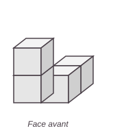
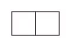
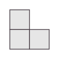
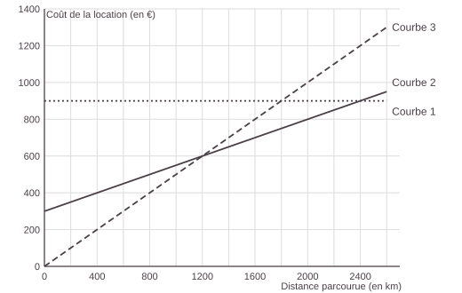
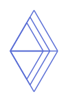
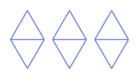
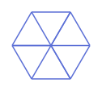
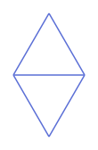

# Annales du brevet 2024 (sujet AA1)

> [!abstract] L'essentiel en 30 secondes
> - Le **vrai sujet** de maths du brevet 2024, série générale, référence 24GENMATAA1 : mêmes textes, mêmes valeurs, mêmes questions.
> - 5 exercices indépendants, 2 h, 100 points : Ex. 1 QCM (20 pts), Ex. 2 (18 pts), Ex. 3 (20 pts), Ex. 4 (26 pts), Ex. 5 Scratch (16 pts).
> - Toutes les réponses doivent être justifiées, sauf indication contraire. Laisse une trace de ta recherche même si tu n'as pas fini.
> - Cherche d'abord sans regarder les corrigés (cachés par défaut).

## Le cours

Les **énoncés** sont repris à l'identique du sujet officiel (DNB, session 2024, © ministère de l'Éducation nationale). Les **figures** sont refaites pour le site (mêmes données, dessin simplifié) et les **corrigés** sont écrits pour t'expliquer la méthode : ils ne sont pas le barème officiel.

| Exercice | Thème | Chapitres à revoir |
|---|---|---|
| 1 | QCM | 03, 04, 06, 09, 15 |
| 2 | Vrai ou faux : solides, Thalès, probabilités | 15, 12, 10 |
| 3 | Triangle, trigonométrie, aire d'un disque | 11, 13, 16 |
| 4 | Location de voiture, fonctions affines | 06, 07, 08, 05 |
| 5 | Scratch, transformations | 17, 14 |

> [!tip] À retenir avant de commencer
> - **Nombre premier** : exactement deux diviseurs, 1 et lui-même (1 n'est pas premier).
> - **Patron d'un cube d'arête $a$** : 6 carrés, aire totale $6a^2$.
> - **Format 16 : 9** : les longueurs sont proportionnelles à 16 et à 9.
> - **Médiane** : on range la série ; si l'effectif est pair, c'est la moyenne des deux valeurs du milieu.
> - **Réciproque de Thalès** : si $\dfrac{SN}{SO} = \dfrac{SU}{SD}$, alors (NU) // (OD). Si les rapports sont différents, elles ne sont pas parallèles.
> - **Secteur de disque** d'angle $\alpha$ : aire $= \dfrac{\alpha}{360} \times \pi r^2$.
> - **Comparer deux formules** : on écrit un prix en fonction de $x$ pour chacune, puis on résout l'équation « prix 1 = prix 2 ».
> - **Scratch** : un tour complet fait 360°.

```quiz Sujet 2024 AA1 : échauffement
? 49 est-il un nombre premier ?
+ Non, car $49 = 7 \times 7$
- Oui, car il est impair
- Oui, car il n'est pas divisible par 2, 3 ou 5
- Non, car il est supérieur à 40
> 49 = 7 × 7 a trois diviseurs (1, 7 et 49) : il n'est pas premier.

? Quelle est l'aire totale du patron d'un cube d'arête 3 cm (en cm²) ?
= 54
> 6 × 3² = 6 × 9 = 54 cm².

? Un écran est au format 4 : 3. Sa longueur est de 20 cm. Combien mesure sa largeur (en cm) ?
= 15
> 20 × 3 ÷ 4 = 15 cm.

? Quelle est la médiane de la série 1 ; 2 ; 4 ; 5 ; 8 ; 9 ?
= 4,5
> 6 valeurs : on prend la moyenne des deux valeurs du milieu, (4 + 5) ÷ 2 = 4,5.

? Quelle est l'aire d'un quart de disque de rayon 10 cm, arrondie au dixième de cm² ?
= 78,5
> (1/4) × π × 10² = 25π ≈ 78,5 cm².

? Une formule de location coûte 0,4 € par kilomètre. Combien coûtent 200 km (en €) ?
= 80
> 0,4 × 200 = 80 €.

? Résous l'équation $0{,}2x + 100 = 0{,}4x$. (écris le nombre seul)
= 500
> 100 = 0,4x − 0,2x = 0,2x, donc x = 100 ÷ 0,2 = 500.

? Dans un triangle SOD, N est sur [SO] et U sur [SD]. SN/SO = 1/2 mais SU/SD = 5/11. Les droites (NU) et (OD) sont-elles parallèles ?
+ Non, car les deux rapports sont différents
- Oui, car SN/SO est égal à 1/2
- Oui, car N et U sont alignés avec S
- On ne peut pas savoir
> D'après la réciproque de Thalès, il faut des rapports égaux. Ici 1/2 ≠ 5/11 : les droites ne sont pas parallèles.
```

## Exercices corrigés

### Exercice 1 (20 points) : QCM

> [!question] Exercice 1 : QCM
> Cet exercice est un questionnaire à choix multiples (QCM). Aucune justification n'est demandée. Pour chaque question, quatre réponses (A, B, C et D) sont proposées. Une seule réponse est exacte. Recopier sur la copie le numéro de la question et la réponse.
>
> **Question 1** : Lequel de ces quatre nombres est premier ?
>
> | Réponse A | Réponse B | Réponse C | Réponse D |
> |---|---|---|---|
> | 1 | 21 | 37 | 54 |
>
> **Question 2** : L'aire totale du patron d'un cube d'arête 5 cm est égale à…
>
> | Réponse A | Réponse B | Réponse C | Réponse D |
> |---|---|---|---|
> | 125 cm² | 150 cm² | 120 cm² | 100 cm² |
>
> **Question 3** : Une forme factorisée de l'expression littérale $4x^2 - 9$ est…
>
> | Réponse A | Réponse B | Réponse C | Réponse D |
> |---|---|---|---|
> | $(4x - 3)(4x + 3)$ | $(2x - 3)(2x + 3)$ | $(2x - 3)^2$ | $(4x - 9)(4x + 9)$ |
>
> **Question 4** : Un écran de télévision est au format 16 : 9 ce qui signifie que la longueur et la largeur de l'écran sont dans le ratio 16 : 9. Dans ce cas, si la longueur de l'écran est de 110 cm, sa largeur est d'environ…
>
> | Réponse A | Réponse B | Réponse C | Réponse D |
> |---|---|---|---|
> | 62 cm | 103 cm | 196 cm | 94 cm |
>
> **Question 5** : On considère la série de valeurs : $4{,}1$ ; $3{,}67$ ; $4{,}23$ ; $4{,}5$ ; $3{,}4$. Quelle est la médiane de cette série ?
>
> | Réponse A | Réponse B | Réponse C | Réponse D |
> |---|---|---|---|
> | $0{,}83$ | $4{,}1$ | $4{,}23$ | $3{,}98$ |

> [!success]- Corrigé de l'exercice 1
> **Question 1 : réponse C.** Un nombre premier a exactement deux diviseurs : 1 et lui-même. 1 n'est pas premier (un seul diviseur) ; $21 = 3 \times 7$ ; $54 = 2 \times 27$ ; mais **37** n'est divisible ni par 2, 3, 5 (il est inférieur à $7^2 = 49$, il suffit de tester 2, 3, 5) : il est premier.
>
> **Question 2 : réponse B.** Le patron d'un cube est formé de 6 carrés de côté 5 cm. Aire d'un carré : $5 \times 5 = 25$ cm². Aire totale : $6 \times 25 = \mathbf{150}$ cm².
>
> **Question 3 : réponse B.** $4x^2 - 9 = (2x)^2 - 3^2 = (2x - 3)(2x + 3)$ (identité remarquable $a^2 - b^2$). Vérification : $(2x-3)(2x+3) = 4x^2 + 6x - 6x - 9 = 4x^2 - 9$.
>
> **Question 4 : réponse A.** Les longueurs sont proportionnelles à 16 et 9 : $\dfrac{\text{largeur}}{110} = \dfrac{9}{16}$, donc largeur $= \dfrac{110 \times 9}{16} = 61{,}875 \approx \mathbf{62}$ cm.
>
> **Question 5 : réponse B.** On range les valeurs dans l'ordre croissant : $3{,}4 \;;\; 3{,}67 \;;\; 4{,}1 \;;\; 4{,}23 \;;\; 4{,}5$. Il y en a 5 : la médiane est la 3<sup>e</sup> valeur, **4,1**.

```quiz Sujet 2024 AA1 : exercice 1 (QCM)
? Question 1. Lequel de ces quatre nombres est premier ?
+ 37
- 1
- 21
- 54
> 1 n'est pas premier ; 21 = 3 × 7 ; 54 est pair. 37 n'est divisible que par 1 et par lui-même.

? Question 2. L'aire totale du patron d'un cube d'arête 5 cm est égale à…
+ 150 cm²
- 125 cm²
- 120 cm²
- 100 cm²
> 6 faces carrées de 5 × 5 = 25 cm² : 6 × 25 = 150 cm².

? Question 3. Une forme factorisée de l'expression littérale $4x^2 - 9$ est…
+ $(2x - 3)(2x + 3)$
- $(4x - 3)(4x + 3)$
- $(2x - 3)^2$
- $(4x - 9)(4x + 9)$
> 4x² − 9 = (2x)² − 3² = (2x − 3)(2x + 3).

? Question 4. Un écran au format 16 : 9 a une longueur de 110 cm. Sa largeur est d'environ…
+ 62 cm
- 103 cm
- 196 cm
- 94 cm
> Largeur = 110 × 9 ÷ 16 = 61,875 ≈ 62 cm.

? Question 5. On considère la série de valeurs : 4,1 ; 3,67 ; 4,23 ; 4,5 ; 3,4. Quelle est la médiane de cette série ?
+ $4{,}1$
- $0{,}83$
- $4{,}23$
- $3{,}98$
> Ordre croissant : 3,4 ; 3,67 ; 4,1 ; 4,23 ; 4,5. La médiane est la valeur du milieu : 4,1.
```

### Exercice 2 (18 points)

> [!question] Exercice 2
> Voici quatre affirmations. Pour chacune d'entre elles, justifier si elle est vraie ou fausse.
>
> 1) Voici un assemblage de quatre cubes identiques représenté en perspective cavalière.
>
> 
>
> **Affirmation n°1** : « La vue de droite est représentée par le dessin ci-dessous. »
> *Le dessin n'est pas à l'échelle.*
>
> 
>
> 2) On considère le schéma ci-dessous (qui n'est pas à l'échelle) :
>
> ![Schéma de l'affirmation 2 : triangle SOD rectangle en S, avec N sur [SO], U sur [SD] et E intersection de (OU) et (ND)](annales-2024/aa-ex2-schema.svg)
>
> **Affirmation n°2** : « Les droites (NU) et (OD) sont parallèles. »
>
> 3) On considère deux expériences aléatoires.
> Dans la première expérience aléatoire, on tire une boule dans une urne opaque et on annonce sa couleur. Dans l'urne, il y a 4 boules rouges et 6 boules bleues indiscernables au toucher.
> Dans la seconde expérience aléatoire, on lance un dé non truqué avec des faces numérotées de 1 à 6 et on annonce le nombre qui apparaît sur la face du dessus.
>
> **Affirmation n°3** : « La probabilité d'obtenir une boule bleue dans l'urne est supérieure à la probabilité d'obtenir un nombre pair avec le dé ».

> [!success]- Corrigé de l'exercice 2
> **Affirmation 1 : FAUSSE.** Regardons l'assemblage : il y a une tour de 2 cubes à l'avant gauche, un cube à sa droite à l'avant, et un cube derrière ce dernier. Vu **de la droite**, on voit l'assemblage « de côté » : la profondeur devient la largeur. Le côté avant est à gauche : on y voit la colonne la plus haute (2 cubes), et le côté arrière est à droite : on y voit un seul cube (celui de derrière). On obtient donc **3 carrés** en forme de « L » (2 carrés en hauteur à gauche, 1 carré à droite), et non un rectangle de 2 carrés.
>
> 
>
> **Affirmation 2 : FAUSSE.** Les points O, N, S sont alignés et S, U, D sont alignés. Les marques de la figure montrent que $SN = ON = 6$ cm, donc $SO = 12$ cm. Si (NU) était parallèle à (OD), d'après la **réciproque du théorème de Thalès** on aurait $\dfrac{SN}{SO} = \dfrac{SU}{SD}$. Or :
> $\dfrac{SN}{SO} = \dfrac{6}{12} = 0{,}5$ et $\dfrac{SU}{SD} = \dfrac{5}{5 + 6} = \dfrac{5}{11} \approx 0{,}4545$.
> Les deux rapports sont différents : **(NU) et (OD) ne sont pas parallèles**.
>
> **Affirmation 3 : VRAIE.** Dans l'urne : $4 + 6 = 10$ boules, 6 bleues : $P(\text{bleue}) = \dfrac{6}{10} = 0{,}6$. Avec le dé : les nombres pairs sont 2, 4, 6, soit 3 faces sur 6 : $P(\text{pair}) = \dfrac{3}{6} = 0{,}5$. Comme $0{,}6 > 0{,}5$, l'affirmation est **vraie**.

### Exercice 3 (20 points)

> [!question] Exercice 3
> Trois élèves construisent chacun en vraie grandeur une même figure puis la découpent. Ils obtiennent ainsi, à eux trois, 3 pièces identiques.
>
> Le schéma ci-dessous représente la pièce construite par chaque élève avec les indications suivantes :
> - Les droites (AB) et (CG) sont perpendiculaires.
> - Les points A, C et B sont alignés.
> - L'arc de cercle qui relie le point A au point B a pour centre le point G.
> - AC = CB
> - CG = 10 cm et BG = 20 cm
>
> ![Pièce construite par chaque élève : un arc de cercle de centre G reliant A et B, avec C milieu de [AB]](annales-2024/aa-ex3-piece.svg)
>
> 1. Démontrer que la longueur BC mesure environ $17{,}3$ cm.
> 2. Quelle est l'aire du triangle BAG ? *On donnera une valeur arrondie à l'unité.*
> 3. **a.** Montrer que l'angle $\widehat{CGB}$ mesure exactement $60°$.
>    **b.** En déduire la mesure de l'angle $\widehat{AGB}$.
> 4. Les trois élèves pensent qu'ils peuvent former un disque complet avec leurs 3 pièces. Expliquer pourquoi ils ont raison.
> 5. En déduire l'aire de la pièce obtenue par chacun des élèves. *On donnera une valeur arrondie à l'unité.*

> [!success]- Corrigé de l'exercice 3
> **1.** Le triangle BCG est rectangle en C. D'après le **théorème de Pythagore** : $BG^2 = BC^2 + CG^2$, donc
> $BC^2 = BG^2 - CG^2 = 20^2 - 10^2 = 400 - 100 = 300$, et $BC = \sqrt{300} \approx \mathbf{17{,}3}$ cm. ✓
>
> **2.** Comme $AC = CB$, on a $AB = 2 \times BC = 2\sqrt{300} \approx 34{,}64$ cm. La hauteur du triangle BAG issue de G est [GC], de longueur 10 cm.
> Aire $= \dfrac{AB \times CG}{2} = \dfrac{34{,}64 \times 10}{2} \approx 173{,}2$ cm², soit **173 cm²** à l'unité près.
>
> **3. a.** Dans le triangle CGB rectangle en C, l'angle $\widehat{CGB}$ est adjacent à [CG] et l'hypoténuse est [GB] :
> $\cos(\widehat{CGB}) = \dfrac{CG}{GB} = \dfrac{10}{20} = 0{,}5$. Or $\cos(60°) = 0{,}5$, donc $\widehat{CGB} = \mathbf{60°}$ exactement. ✓
>
> **b.** G est le centre de l'arc : $GA = GB = 20$ cm. Le triangle AGB est isocèle en G, et (GC) est sa hauteur, donc aussi sa bissectrice : $\widehat{AGB} = 2 \times \widehat{CGB} = 2 \times 60° = \mathbf{120°}$.
>
> **4.** Une pièce est un **secteur de disque** de centre G, de rayon 20 cm et d'angle $120°$ (délimité par [GA], [GB] et l'arc AB). Trois pièces placées côte à côte autour de G forment un angle de $3 \times 120° = 360°$ : c'est un tour complet. Les trois secteurs de même rayon recouvrent donc **exactement un disque de rayon 20 cm**. Les élèves ont raison.
>
> **5.** L'aire du disque de rayon 20 cm est $\pi \times 20^2 = 400\pi \approx 1\,256{,}6$ cm². Les trois pièces sont identiques : l'aire d'une pièce est le tiers de celle du disque :
> $\dfrac{400\pi}{3} \approx 418{,}9$ cm², soit **419 cm²** à l'unité près.

### Exercice 4 (26 points)

> [!question] Exercice 4
> Des amis habitent Strasbourg et préparent leurs vacances. Cette année ils ont décidé de partir découvrir une grande ville française pendant une semaine. Pour s'y rendre, ils louent une voiture. Une fois arrivés sur place, ils feront ensuite tous leurs trajets à pied ou en transport en commun.
>
> Une agence de location de voitures propose les trois formules suivantes pour une location sur 1 semaine :
>
> | Formule A | Formule B | Formule C |
> |---|---|---|
> | 0,50 € pour chaque kilomètre parcouru | Forfait fixe de 300 € puis 0,25 € pour chaque kilomètre parcouru | Forfait fixe de 900 € pour un kilométrage illimité. |
>
> **Tableau indicatif des distances (en km) entre des villes françaises.**
>
> | | Bordeaux | Grenoble | Lille | Marseille | Nantes | Paris |
> |---|---|---|---|---|---|---|
> | **Grenoble** | 675 | | | | | |
> | **Lille** | 792 | 771 | | | | |
> | **Marseille** | 555 | 280 | 1005 | | | |
> | **Nantes** | 338 | 741 | 584 | 909 | | |
> | **Paris** | 546 | 585 | 215 | 772 | 379 | |
> | **Strasbourg** | 907 | 506 | 498 | 803 | 864 | 442 |
>
> *Exemple : la distance la plus courte entre Nantes et Grenoble est de 741 km.*
>
> **PARTIE A :** Les amis souhaitent se rendre à Marseille. Ils ont un budget de 1 000 € pour le voyage.
>
> 1. Quelle distance, en km, vont-ils parcourir pour le trajet aller-retour ?
> 2. En choisissant la formule B, montrer que la location de voiture coûtera 701,50 €.
> 3. Quelle est la formule la plus avantageuse ?
> 4. Voici des informations pour le voyage :
>
> | Information 1 | Information 2 | Information 3 |
> |---|---|---|
> | Prix moyen du gazole en 2023 : 1,87 € par litre | Voiture proposée. Type de carburant : gazole. Consommation : 5,6 L pour 100 km | Coût total pour les péages : 115,80 € |
>
> Leur budget sera-t-il suffisant ? *Dans cette question, toute trace de recherche sera prise en compte dans la correction.*
>
> **PARTIE B : Étude des formules**
>
> | Formule A | Formule B | Formule C |
> |---|---|---|
> | 0,50 € pour chaque kilomètre parcouru | Forfait fixe de 300 € puis 0,25 € pour chaque kilomètre parcouru | Forfait fixe de 900 € pour un kilométrage illimité. |
>
> 5. Soit $x$ le nombre de kilomètres parcourus, exprimer en fonction de $x$ le prix payé pour chaque formule de location.
> 6. On a représenté ci-dessous, pour chacune des formules, le coût de la location (en euros) en fonction de la distance parcourue (en kilomètres).
>
> 
>
>    Associer chaque courbe à la formule de location correspondante. *Ne pas justifier.*
> 7. Résoudre l'équation $0{,}25x + 300 = 0{,}5x$. Interpréter ce résultat.
> 8. **a.** Si la distance parcourue est de 2 500 km, quelle formule doit-on choisir pour payer le moins cher ? *Ne pas justifier.*
>    **b.** Donner une distance parcourue pour laquelle la formule A est la plus intéressante. *Ne pas justifier.*
>    **c.** Déterminer graphiquement quelle formule de location est la moins chère en fonction de la distance parcourue pour une distance inférieure à 2 600 km.

> [!success]- Corrigé de l'exercice 4
> **Partie A**
>
> **1.** Dans le tableau, à l'intersection de la ligne « Strasbourg » et de la colonne « Marseille », on lit **803 km** pour un aller. L'aller-retour fait $2 \times 803 = \mathbf{1\,606}$ km.
>
> **2.** Formule B : forfait de 300 € plus 0,25 € par kilomètre :
> $300 + 0{,}25 \times 1\,606 = 300 + 401{,}5 = \mathbf{701{,}50}$ €. ✓
>
> **3.** On calcule le prix des trois formules pour 1 606 km :
> - Formule A : $0{,}5 \times 1\,606 = 803$ €
> - Formule B : $701{,}50$ €
> - Formule C : $900$ €
>
> La moins chère est la **formule B** (701,50 €).
>
> **4.** On ajoute à la location (formule B) le coût du carburant et des péages.
> - Carburant : 5,6 L pour 100 km, donc pour 1 606 km : $5{,}6 \times \dfrac{1\,606}{100} = 5{,}6 \times 16{,}06 = 89{,}936$ L. Prix : $89{,}936 \times 1{,}87 \approx 168{,}18$ €.
> - Péages : $115{,}80$ €.
>
> Total : $701{,}50 + 168{,}18 + 115{,}80 = \mathbf{985{,}48}$ €.
> Comme $985{,}48 < 1\,000$, **leur budget sera suffisant** (il leur restera environ 14,52 €).
>
> **Partie B**
>
> **5.** Le prix en fonction de $x$ (en km) :
> - Formule A : $\mathbf{0{,}5x}$
> - Formule B : $\mathbf{0{,}25x + 300}$
> - Formule C : $\mathbf{900}$ (constant)
>
> **6.**
> - **Courbe 1** : droite horizontale (prix constant, 900 €) : **formule C**.
> - **Courbe 2** : droite qui part de 300 € quand $x = 0$ : **formule B**.
> - **Courbe 3** : droite qui part de l'origine (0 € pour 0 km) et monte le plus vite : **formule A**.
>
> **7.** $0{,}25x + 300 = 0{,}5x$
> $300 = 0{,}5x - 0{,}25x = 0{,}25x$
> $x = \dfrac{300}{0{,}25} = \mathbf{1\,200}$.
> *Interprétation :* pour une distance de **1 200 km**, les formules A et B coûtent le même prix ($0{,}5 \times 1\,200 = 600$ €). Avant 1 200 km, la formule A est moins chère ; après, c'est la formule B.
>
> **8. a.** Pour 2 500 km : formule A $= 1\,250$ €, formule B $= 0{,}25 \times 2\,500 + 300 = 925$ €, formule C $= 900$ €. La moins chère est la **formule C**.
>
> **b.** La formule A est la plus intéressante pour une distance inférieure à 1 200 km, par exemple **500 km** ($A = 250$ €, $B = 425$ €, $C = 900$ €).
>
> **c.** Par lecture graphique, on regarde quelle courbe est la plus basse :
> - de 0 à 1 200 km environ : la courbe 3 est la plus basse : **formule A** ;
> - de 1 200 km à 2 400 km environ : la courbe 2 est la plus basse : **formule B** ;
> - de 2 400 km à 2 600 km : la courbe 1 est la plus basse : **formule C**.
>
> *(Le croisement de B et C se calcule : $0{,}25x + 300 = 900$ donne $x = 2\,400$.)*

### Exercice 5 (16 points) : Scratch

> [!question] Exercice 5
> On donne le programme suivant.
>
> *Rappel : l'instruction « s'orienter à 90 » signifie que l'on s'oriente vers la droite.*
>
> **Script principal**
> - quand 🏴 est cliqué
> - aller à x : −100 y : 0
> - s'orienter à 90
> - effacer tout
> - mettre *côté* à 80
> - Motif
>
> **Motif**
> - définir Motif
> - stylo en position d'écriture
> - répéter 3 fois :
>   - avancer de (*côté*) pas
>   - tourner ↺ de 120 degrés
> - répéter 3 fois :
>   - avancer de (*côté*) pas
>   - tourner ↻ de 120 degrés
> - relever le stylo
>
> Dans cet exercice, aucune justification n'est attendue.
>
> 1. À quelles coordonnées le lutin se positionne-t-il juste après avoir cliqué sur le drapeau vert ?
> 2. En prenant 1 cm pour 20 pas, dessiner en vraie grandeur la figure obtenue en exécutant le script principal.
> 3. On modifie le script principal de trois façons différentes. Associer chaque script à la figure qui lui correspond.
>
> | Script n°1 | Script n°2 | Script n°3 |
> |---|---|---|
> | quand 🏴 est cliqué | quand 🏴 est cliqué | quand 🏴 est cliqué |
> | aller à x : −100 y : 0 | aller à x : −100 y : 0 | aller à x : −100 y : 0 |
> | s'orienter à 90 | s'orienter à 90 | s'orienter à 90 |
> | effacer tout | effacer tout | effacer tout |
> | mettre côté à 80 | mettre côté à 80 | mettre côté à 80 |
> | répéter 3 fois : | répéter 3 fois : | répéter 3 fois : |
> | &nbsp;&nbsp;Motif | &nbsp;&nbsp;Motif | &nbsp;&nbsp;Motif |
> | &nbsp;&nbsp;avancer de 100 pas | &nbsp;&nbsp;mettre côté à (côté × 1,2) | &nbsp;&nbsp;tourner ↺ de 120 degrés |
>
> | Figure A | Figure B | Figure C |
> |---|---|---|
> |  |  |  |
>
> 4. Dans cette question on s'intéresse au script n°2.
>    **a.** Combien de fois le bloc « motif » est-il exécuté ?
>    **b.** Quelle est la valeur de la variable « côté » à la fin de ce script ?

> [!success]- Corrigé de l'exercice 5
> **1.** Juste après le clic sur le drapeau vert, l'instruction « aller à x : −100 y : 0 » place le lutin en $(-100\;;\;0)$.
>
> **2.** Le côté vaut 80 pas, soit $80 \div 20 = 4$ cm. Le bloc Motif trace d'abord trois côtés en tournant à **gauche** de 120° : un **triangle équilatéral de 4 cm** de côté. Puis il trace trois côtés en tournant à **droite** de 120° : un second triangle équilatéral de 4 cm, de l'autre côté du segment de départ. Les deux triangles partagent le côté horizontal de départ : on obtient un **losange** formé de deux triangles équilatéraux de côté 4 cm, dont la diagonale horizontale va de $(-100\;;\;0)$ à $(-20\;;\;0)$.
>
> 
>
> **3.**
> - **Script n°1** : après chaque motif, le lutin avance de 100 pas dans la direction de départ. Les trois losanges sont **décalés** de 100 pas et séparés (le losange mesure 80 pas de large) : **figure B**.
> - **Script n°2** : le motif est retracé trois fois depuis le même point de départ, avec un côté de plus en plus grand ($80$, puis $96$, puis $115{,}2$) : trois losanges **emboîtés** qui ont le même sommet de gauche : **figure A**.
> - **Script n°3** : après chaque motif, le lutin tourne de 120° sans avancer : les trois losanges ont le **même sommet**, tournés de 120° les uns par rapport aux autres : ils forment un hexagone, **figure C**.
>
> **4. a.** Le bloc « Motif » est dans une boucle « répéter 3 fois » : il est exécuté **3 fois**.
>
> **b.** La valeur de départ est 80. À la fin de chaque tour, on multiplie par 1,2. Après 3 tours : $80 \times 1{,}2 \times 1{,}2 \times 1{,}2 = 80 \times 1{,}728 = \mathbf{138{,}24}$.

### Petits exercices pour s'entraîner

> [!question] Petit exercice A
> Deux formules de location : X coûte 0,30 € par km ; Y coûte 100 € de forfait puis 0,10 € par km. Pour quelle distance les deux formules coûtent-elles le même prix ?

> [!success]- Corrigé du petit exercice A
> Prix de X : $0{,}3x$. Prix de Y : $0{,}1x + 100$.
> $0{,}3x = 0{,}1x + 100$, donc $0{,}2x = 100$ et $x = \mathbf{500}$ km. Pour 500 km, les deux coûtent $150$ €.

> [!question] Petit exercice B
> Un disque de rayon 6 cm est partagé en 4 secteurs identiques. Quelle est l'aire d'un secteur, arrondie au dixième ?

> [!success]- Corrigé du petit exercice B
> Aire du disque : $\pi \times 6^2 = 36\pi$. Un secteur en est le quart : $\dfrac{36\pi}{4} = 9\pi \approx \mathbf{28{,}3}$ cm².

## Voir aussi

[[22 - Annales du brevet 2024 (Métropole, Antilles-Guyane)]] · [[21 - Annales du brevet 2024 (Polynésie)]] · [[20 - Annales du brevet 2025 (Polynésie)]] · [[19 - Annales du brevet 2025 (série générale)]] · [[17 - Algorithmique et Scratch]]
