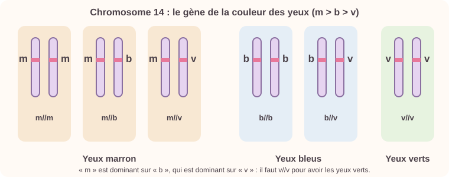
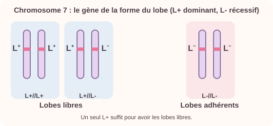
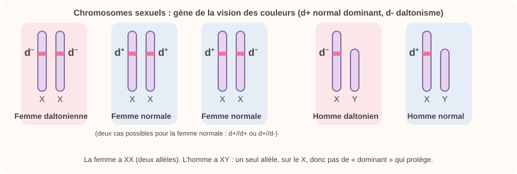
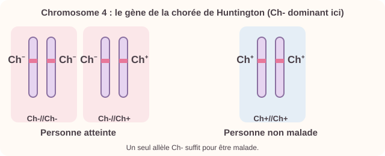
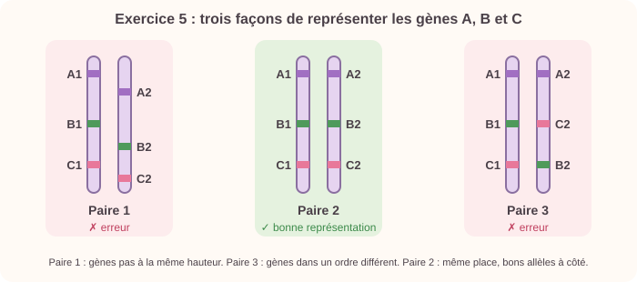
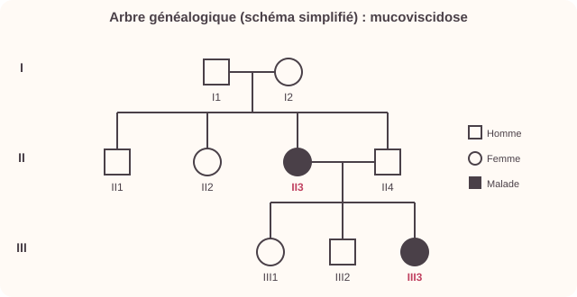

# Génétique : l'ADN et l'hérédité

> [!abstract] L'essentiel en 30 secondes
> - Les **caractères héréditaires** (groupe sanguin, couleur des yeux…) sont transmis des parents aux enfants. Ils peuvent aussi être influencés par l'**environnement**.
> - L'**information génétique** est portée par l'**ADN**, une molécule contenue dans les **chromosomes**, dans le **noyau** de chaque cellule.
> - L'être humain a **46 chromosomes** (23 **paires**), dont une paire de chromosomes sexuels (**XX** chez la femme, **XY** chez l'homme).
> - Un **gène** est une portion d'ADN qui gouverne un caractère. Il existe en plusieurs versions : les **allèles**.
> - Chaque individu est **unique** (sauf les vrais jumeaux) car il a une combinaison d'allèles unique.

## Cours de classe (prioritaire)

Chapitre 2 du cours d'Eléa : **« Chromosomes et informations héréditaires »**. Cette partie reprend ses définitions et ses mots (ADN, gène, génome, allèle, dominant, récessif, codominants), puis les exercices d'application avec leurs schémas refaits. Ce qui suit dans la fiche complète le cours.

> [!abstract] Le bilan en 30 secondes
> - L'**ADN** est une molécule qui constitue le chromosome. Il est toujours présent dans le **noyau** des cellules.
> - Les chromosomes ne sont **visibles** que pendant la **division cellulaire**, car c'est le seul moment où l'ADN se **compacte**.
> - Les chromosomes contiennent les **gènes**. Le **génome** est l'ensemble des gènes portés par un individu.
> - Un gène peut exister sous des versions différentes : les **allèles**. En général, une cellule a **deux exemplaires** de chaque gène, à la **même position** sur les deux chromosomes d'une paire (les chromosomes **homologues**).
> - Deux allèles **différents** : soit les deux s'expriment (**codominants**), soit un seul s'exprime (**dominant**) et l'autre est **récessif**.
> - Chaque cellule possède **tout** le programme génétique de l'individu, mais n'en exprime qu'une **partie**.

### I. La constitution des chromosomes

*Question : de quoi sont constitués les chromosomes ? (Activité 1 : extraction de l'ADN, avec choux-fleur, gros sel, éthanol, mortier, pilon, gaze et tube à essais.)*

- **ADN** : acide désoxyribonucléique. C'est une **longue molécule** présente dans le noyau des cellules. Elle **se pelotonne** au début de la multiplication cellulaire et forme alors un **chromosome visible**.
- **Chaque chromosome est constitué d'ADN.**
- On voit les chromosomes **seulement pendant la division cellulaire**, parce que c'est le seul moment où l'ADN se compacte.

### II. Les chromosomes contiennent des gènes

*Question : comment les informations sont-elles disposées sur les chromosomes ? (Activité 2 : la maladie du cri du chat.)*

Dans l'activité, les enfants atteints ont un caryotype normal (23 paires) mais, sur le **chromosome n° 5**, il **manque la partie supérieure**. Cette anomalie entraîne un retard mental, une tête anormalement petite, un visage lunaire et des cris qui ressemblent à des miaulements. Il manque donc des **informations héréditaires**.

> [!info] Définitions de la classe
> - **Gène** : portion d'ADN qui détermine un caractère héréditaire. Un gène contient donc une partie de l'information héréditaire portée par l'ADN. Il **gouverne la transmission** d'un caractère héréditaire précis et occupe un **emplacement déterminé** sur un chromosome.
> - **Génome** : l'ensemble des gènes portés par un individu.

### III. Les allèles sont des versions différentes d'un gène

*Question : les informations portées par les gènes sont-elles identiques sur les chromosomes homologues (« de la même paire ») ? (Activité 3 : les groupes sanguins, gène porté par le chromosome n° 9.)*

- Le gène du groupe sanguin existe **deux fois** dans chaque cellule, car il y a **deux chromosomes n° 9**.
- L'information n'est **pas obligatoirement la même** sur les deux chromosomes homologues : le groupe AB, par exemple, a un chromosome qui porte A et l'autre qui porte B.
- **Allèle** : version d'un gène. Les deux allèles d'un gène sont situés **au même endroit** sur les deux chromosomes d'une paire. Pour le groupe sanguin, les allèles possibles sont **A, B ou O**.
- Les molécules à la surface des **hématies** (globules rouges) changent d'un groupe à l'autre : groupe A, molécule a ; groupe B, molécule b ; groupe AB, molécules a et b ; groupe O, pas de molécules.
- Groupe **O** : donneur universel (receveur exclusif). Groupe **AB** : donneur exclusif (receveur universel).

> [!info] Dominant, récessif, codominants
> - Les allèles **dominants** s'expriment toujours.
> - Les allèles **récessifs** ne s'expriment que s'ils sont les **seuls** présents.
> - Les allèles **codominants** s'expriment **ensemble**.

| Allèles présents | A//A | B//B | A//B | A//O | B//O | O//O |
|---|---|---|---|---|---|---|
| Allèle qui s'exprime | A | B | A et B | A | B | O |
| Groupe sanguin | A | B | AB | A | B | O |

| Les deux allèles sont **identiques** (un seul allèle) | Les deux allèles sont **différents** : les deux s'expriment | Les deux allèles sont **différents** : un seul s'exprime |
|---|---|---|
| L'allèle s'exprime | Le caractère combine les deux allèles | Caractère de l'allèle dominant |

> [!tip] Je dois savoir (page de la classe)
> - De quoi est constitué un chromosome ?
> - À quel moment les chromosomes sont-ils visibles, et pourquoi ?
> - Les définitions de : **ADN, gène, génome, allèle, récessif, dominant et codominant**.
> - Je dois savoir **faire** : suivre un protocole, réaliser une manipulation, **schématiser des gènes et des allèles**.

### Exercices d'application (corrigés avec schémas)

> [!question] Exercice 1 : la couleur des yeux
> Le gène de la couleur des yeux est sur le chromosome 14. Il y a trois allèles : **m** (yeux marron), **b** (yeux bleus), **v** (yeux verts). L'allèle marron s'exprime même s'il est seul, et l'allèle bleu est dominant sur l'allèle vert. a) Précise la règle de dominance. b) Schématise les combinaisons possibles pour une personne aux yeux marron, bleus, verts.

> [!success]- Corrigé
> a) **m > b > v** : m est dominant sur b et v, b est dominant sur v. L'allèle **v est donc récessif**.
>
> b) Yeux **marron** : m//m, m//b ou m//v. Yeux **bleus** : b//b ou b//v. Yeux **verts** : v//v seulement.
>
> 

> [!question] Exercice 2 : les lobes d'oreille
> Deux formes de lobes : **libres** (décollés) et **adhérents** (collés au cou). Le gène est sur le chromosome 7, avec deux allèles : **L+** (lobes libres) et **L-** (qui ne s'exprime pas en présence du premier, lobes adhérents). 1) Sur quel chromosome est le gène ? 2) Quels sont les allèles ? 3) Quelles sont les dominances ? 4) Schématise les chromosomes d'une personne aux lobes libres, puis aux lobes adhérents.

> [!success]- Corrigé
> 1) Le **chromosome 7**.
> 2) L+ (lobes libres) et L- (lobes adhérents).
> 3) **L+ est dominant**, **L- est récessif**.
> 4) Lobes libres : L+//L+ ou L+//L-. Lobes adhérents : L-//L- seulement.
>
> 

> [!question] Exercice 3 : le daltonisme
> Le gène de la vision des couleurs est sur le chromosome **X**. L'allèle **d+** donne une vision normale ; l'allèle **d-** donne le daltonisme et ne s'exprime pas en présence du premier. 1) Quels sont les chromosomes sexuels d'un homme, d'une femme ? 2) Schématise la paire de chromosomes sexuels d'une femme daltonienne, d'une femme à vision normale, d'un homme daltonien, d'un homme à vision normale.

> [!success]- Corrigé
> 1) Homme : **X et Y**. Femme : **X et X**.
> 2) Femme daltonienne : X d-, X d-. Femme normale : d+//d+ ou d+//d-. Homme daltonien : X d-, et Y (sans allèle de ce gène). Homme normal : X d+, et Y.
>
> 

> [!question] Exercice 4 : la chorée de Huntington
> Maladie génétique rare : il suffit d'**un seul** allèle pour être malade. Le gène est sur le chromosome 4. 1) Précise les allèles possibles et nomme-les. 2) Schématise la paire n° 4 d'une personne atteinte, puis non malade.

> [!success]- Corrigé
> 1) Deux allèles : celui qui provoque la chorée de Huntington, nommé **Ch-**, et celui qui n'entraîne pas de maladie, nommé **Ch+**.
> 2) Personne atteinte : Ch-//Ch- ou Ch-//Ch+. Personne non malade : Ch+//Ch+.
>
> 

> [!question] Exercice 5 : trois paires de chromosomes
> Trois gènes A, B et C sont localisés sur une paire de chromosomes (allèles A1, A2, B1, B2, C1, C2). Entoure la bonne représentation parmi trois et justifie.

> [!success]- Corrigé
> La bonne représentation est la **numéro 2**, car :
> - un gène occupe **toujours la même position** sur les deux chromosomes homologues ;
> - les allèles d'un même gène doivent être inscrits **à côté du gène** correspondant.
>
> 
>
> *Schéma refait pour illustrer l'idée : les trois dessins de l'énoncé sont sur la photo du sujet.*

> [!question] Exercice 6 : la mucoviscidose
> La mucoviscidose atteint les poumons : le mucus est produit en trop grande quantité. Le gène est sur le chromosome 7, avec deux allèles : **m** (maladie, récessif) et **M** (production normale de mucus). Arbre généalogique d'une famille. 1) Nomme les personnes atteintes. 2) Quels sont les phénotypes possibles ? 3) Indique les génotypes possibles pour III1 et II3.

> [!success]- Corrigé
> 1) Les personnes atteintes sont **II3** et **III3**.
> 2) Deux phénotypes : **atteint de la mucoviscidose** ou **production normale de mucus**.
> 3) **III1**, production normale : **M//m ou M//M** (M est dominant). **II3**, atteinte : forcément **m//m** (m est récessif).
>
> 
>
> *Arbre redessiné de façon simplifiée : il met en évidence II3 et III3, les personnes atteintes. L'arbre exact est sur la photo de l'énoncé.*

### Quiz du cours de classe

```quiz ADN, chromosomes et gènes
? De quoi sont constitués les chromosomes ?
- de protéines uniquement
+ d'ADN
- de globules rouges
> Chaque chromosome est constitué d'ADN.

? Pendant quelle période voit-on les chromosomes dans une cellule ?
- tout le temps
+ pendant la division cellulaire
- jamais, ils sont trop petits
> C'est le seul moment où l'ADN se compacte.

? Où se trouve l'ADN dans la cellule ?
= noyau
> L'ADN est toujours présent dans le noyau.

? ADN veut dire…
+ acide désoxyribonucléique
- acide diazotique
- anomalie dans le noyau
> C'est une longue molécule.

? Un gène est…
+ une portion d'ADN qui détermine un caractère héréditaire
- la même chose qu'un chromosome
- une cellule
> Un gène occupe un emplacement déterminé sur un chromosome.

? Comment appelle-t-on l'ensemble des gènes portés par un individu ?
= génome
> Le génome est l'ensemble des gènes d'un individu.

? Dans la maladie du cri du chat, que constate-t-on sur le chromosome n° 5 ?
- il y en a un de trop
+ il manque une partie, donc des informations héréditaires
- il est identique à celui d'un chromosome normal
> Il manque la partie supérieure, d'où le retard mental et les cris de miaulement.

? Les enfants atteints du cri du chat ont un caryotype normal : ils possèdent 23 paires de chromosomes.
+ Vrai
- Faux
> Le nombre de chromosomes est normal, c'est le chromosome 5 qui est anormal.
```

```quiz Allèles : dominant, récessif, codominants
? Les différentes versions d'un même gène s'appellent…
= allèles
> Un gène peut exister sous des versions différentes appelées allèles.

? Combien d'exemplaires d'un gène a-t-on en général dans une cellule ?
- 1
+ 2
- 23
> Un exemplaire sur chacun des deux chromosomes de la paire.

? Les deux exemplaires d'un gène sont situés…
+ à la même position sur les deux chromosomes de la paire
- sur le même chromosome
- sur deux paires différentes
> Ce sont les chromosomes homologues.

? Si les deux allèles sont identiques, que se passe-t-il ?
+ cet allèle s'exprime
- aucun allèle ne s'exprime
- le caractère est mélangé
> Dans ce cas, l'allèle représenté est exprimé.

? Si les deux allèles sont différents et que les deux s'expriment, on dit qu'ils sont…
- récessifs
- dominants
+ codominants
> Le caractère combine les deux allèles.

? Un allèle qui ne s'exprime que s'il est seul est…
+ récessif
- dominant
- codominant
> L'allèle récessif est masqué par le dominant.

? Chaque cellule exprime tout le programme génétique de l'individu.
- Vrai
+ Faux
> Chaque cellule possède tout le programme génétique mais n'en exprime qu'une partie.

? Deux chromosomes de la même paire s'appellent…
= homologues
> « De la même paire ».
```

```quiz Les groupes sanguins (activité 3)
? Sur quel chromosome est porté le gène du groupe sanguin (activité 3) ?
- 7
+ 9
- 14
> Le gène du groupe sanguin est sur le chromosome n° 9.

? Quels sont les allèles possibles du groupe sanguin ?
+ A, B et O
- A et B seulement
- O seulement
> Trois allèles pour un gène.

? Quel groupe a une personne A//O ?
= A
> A est dominant sur O.

? Quel groupe a une personne A//B ?
= AB
> A et B sont codominants : ils s'expriment ensemble.

? Quel groupe a une personne O//O ?
= O
> O est récessif : il ne s'exprime que s'il est seul.

? Quelles molécules a-t-on à la surface des hématies d'une personne de groupe AB ?
- aucune
- la molécule a seulement
+ les molécules a et b
> Groupe O : pas de molécules. Groupe A : molécule a. Groupe B : molécule b.

? Une hématie est…
= globule rouge
> Les hématies sont les globules rouges.

? Le groupe O est donneur universel.
+ Vrai
- Faux
> Le groupe AB est receveur universel.
```

```quiz Exercices d'application 1 à 6
? Yeux : m est dominant sur b, et b sur v. Quel génotype donne les yeux verts ?
- m//v
- b//v
+ v//v
> v est récessif : il faut deux allèles v.

? Yeux : combien de génotypes possibles pour les yeux marron ?
- 1
- 2
+ 3
> m//m, m//b et m//v.

? Lobes d'oreille : une personne L+//L- a des lobes…
+ libres
- adhérents
> L+ est dominant.

? Lobes d'oreille : quel génotype pour des lobes adhérents ?
= L-//L-
> L- est récessif : il faut deux allèles L-.

? Chez l'homme, les chromosomes sexuels sont…
- XX
+ XY
- YY
> La femme a XX.

? Daltonisme : une femme à vision normale peut avoir le génotype d+//d-.
+ Vrai
- Faux
> d+ est dominant sur d-.

? Daltonisme : pourquoi un homme est-il plus souvent daltonien ?
- il a deux chromosomes X
+ il n'a qu'un seul X, donc un seul allèle du gène
- il n'a pas de chromosome
> Avec un seul allèle d-, rien ne le masque.

? Huntington : une personne Ch-//Ch+ est…
+ atteinte de la maladie
- non malade
> Un seul allèle Ch- suffit pour être malade.

? Huntington : quelle est la seule paire d'une personne non malade ?
= Ch+//Ch+
> Aucun allèle Ch- : pas de maladie.

? Exercice 5 : pourquoi la paire 2 est-elle la bonne représentation ?
+ les gènes sont à la même position sur les deux chromosomes
- les gènes A, B et C sont dans un ordre différent
- chaque chromosome a un gène différent
> Un gène occupe toujours la même position sur les deux chromosomes homologues.

? Mucoviscidose : l'allèle m est récessif. Une personne atteinte a le génotype…
= m//m
> Il faut deux allèles m pour être malade.

? Mucoviscidose : quels génotypes pour une personne à production normale de mucus ?
+ M//M ou M//m
- m//m
- M//M seulement
> M est dominant : un seul M suffit.
```

## Le cours

> [!info] Mots-clés
> | Terme | Définition simple |
> |---|---|
> | ADN | La molécule qui contient l'information génétique. |
> | Chromosome | Un « paquet » d'ADN très enroulé, dans le noyau. |
> | Gène | Une portion d'ADN qui commande un caractère. |
> | Allèle | Une version possible d'un gène. |
> | Caryotype | La photo des chromosomes d'une cellule, rangés par paires. |
> | Gamète | Cellule reproductrice : spermatozoïde ou ovule. |
> | Mutation | Un changement dans l'ADN. |

### 1. Du caractère au gène

| Échelle | Élément |
|---|---|
| Organisme | Caractère (ex. : groupe sanguin) |
| Cellule | Noyau |
| Noyau | Chromosomes |
| Chromosome | Molécule d'ADN |
| Portion d'ADN | **Gène** (et ses allèles) |

- Le **caryotype** est la photographie des chromosomes d'une cellule, classés par paires et par taille.
- Dans chaque paire, un chromosome vient de la **mère**, l'autre du **père**.
- Les **gamètes** (spermatozoïdes, ovules) n'ont que **23 chromosomes** (un de chaque paire).

> [!example] Exemple guidé : lire un caryotype
> **Question :** un caryotype montre 46 chromosomes dont une paire XY. Qui est-ce ? A-t-il une anomalie ?
> 1. **Étape 1 : je repère.** Je compte : 46 chromosomes, donc 23 paires. Je regarde la paire sexuelle : **XY**.
> 2. **Étape 2 : j'applique.** XY correspond à un **garçon**. Je vérifie qu'aucune paire n'a trois chromosomes.
> 3. **Étape 3 : je conclus.** C'est un garçon, sans anomalie du nombre de chromosomes visible : 23 paires normales.

> [!info] En clair
> Imagine l'ADN comme un immense livre de recettes. Chaque **gène** est une recette (par exemple « groupe sanguin »). Les **allèles** sont les différentes versions de cette recette. Tu as deux exemplaires du livre : un reçu de ta mère, un de ton père. Pour chaque recette, tu as donc deux versions. Selon qu'elles sont identiques, différentes, dominantes ou récessives, le résultat change.

### 2. Gènes et allèles

- Un même **gène** occupe la même place sur les deux chromosomes d'une paire.
- Il peut exister sous différentes **versions** : les **allèles**. Exemple : le gène du groupe sanguin a trois allèles principaux (A, B, O).
- Comme on a deux exemplaires de chaque chromosome, on a **deux allèles** pour chaque gène (identiques ou différents).
- Un allèle **dominant** s'exprime même s'il n'est présent qu'en un exemplaire ; un allèle **récessif** ne s'exprime que s'il est présent en **deux** exemplaires.

> [!example] Le groupe sanguin
> - Allèles A et O : groupe **A** (O est récessif).
> - Allèles A et B : groupe **AB** (A et B s'expriment tous les deux : codominance).
> - Allèles O et O : groupe **O**.

> [!example] Exemple guidé : prévoir les groupes sanguins d'enfants
> **Question :** un père A//O et une mère B//O. Quels groupes peuvent avoir leurs enfants ?
> 1. **Étape 1 : je repère.** Le père donne **A ou O** ; la mère donne **B ou O**. Chaque gamète en reçoit un seul.
> 2. **Étape 2 : j'applique.** Je croise : A+B = A//B ; A+O = A//O ; O+B = B//O ; O+O = O//O.
> 3. **Étape 3 : je conclus.** Groupes possibles : **AB**, **A**, **B** et **O**. Les quatre sont possibles, avec une chance sur quatre à chaque fois.

### 3. Anomalies chromosomiques

Un nombre anormal de chromosomes peut avoir des conséquences : la **trisomie 21** (3 chromosomes 21 au lieu de 2, soit 47 chromosomes) est due à une erreur lors de la formation des gamètes.

### 4. Mutations

Une **mutation** est une modification de la séquence de l'ADN. Elle peut créer un nouvel **allèle**. Elle peut être neutre, favorable ou défavorable. Certaines sont provoquées par des agents **mutagènes** (UV, tabac, rayonnements).

### 5. Gènes et environnement

Un caractère dépend des gènes **et** de l'**environnement** : la couleur de la peau dépend des gènes mais aussi de l'exposition au soleil ; la taille dépend aussi de l'alimentation.

> [!warning] Les pièges classiques
> - Ne confonds pas **gène** (la recette) et **allèle** (une version de la recette).
> - Un **gamète** a **23** chromosomes (pas 46) : un de chaque paire.
> - Un caractère ne dépend pas que des gènes : l'**environnement** joue aussi (taille, peau bronzée).
> - Un enfant peut avoir un groupe que **aucun de ses parents** n'a : les parents A//O et B//O peuvent avoir un enfant O.

> [!tip] Pour retenir
> Du plus gros au plus petit : **cellule → noyau → chromosome → ADN → gène → allèle.**
> Phrase : « Dans le **noyau**, les **chromosomes** sont faits d'**ADN**, avec des **gènes** qui ont des **allèles**. »
> Humain : **46** chromosomes dans le corps, **23** dans les gamètes. **XX** = fille, **XY** = garçon.

> [!abstract] Ce que tu dois savoir faire
> - Je sais situer l'ADN, les chromosomes et les gènes dans la cellule.
> - Je sais lire un caryotype (nombre, sexe, trisomie 21).
> - Je sais expliquer la différence entre gène et allèle.
> - Je sais déterminer les groupes sanguins possibles pour des enfants.
> - Je sais dire qu'un caractère dépend des gènes et de l'environnement.

## Exercices corrigés

> [!question] Exercice 1
> Le caryotype d'un individu montre 47 chromosomes avec trois chromosomes 21 et deux chromosomes X. Que peut-on en dire ?

> [!success]- Corrigé
> Il possède deux chromosomes **X** : c'est une **fille**. Elle a **trois chromosomes 21** au lieu de deux : elle est atteinte de **trisomie 21**.

> [!question] Exercice 2
> Un père de groupe AB et une mère de groupe O (allèles O//O) ont des enfants. Quels groupes sanguins peuvent-ils avoir ?

> [!success]- Corrigé
> Le père transmet soit **A** soit **B** ; la mère transmet toujours **O**.
> Combinaisons possibles : A//O (groupe **A**) ou B//O (groupe **B**). Les enfants ne peuvent être ni AB ni O.

> [!question] Exercice 3
> Une mutation survient dans l'ADN d'une cellule de peau exposée au soleil. Sera-t-elle transmise aux enfants ? Explique.

> [!success]- Corrigé
> Non, en général. Une mutation dans une cellule de la peau (cellule du corps) **ne se transmet pas** aux enfants. Seules les mutations qui touchent les **cellules reproductrices (gamètes)** peuvent être transmises à la descendance. Les UV sont un agent **mutagène** : on se protège avec de la crème solaire.

> [!question] Exercice 4 (type brevet)
> Document 1 : arbre généalogique d'une famille. Les deux parents, Paul (groupe A) et Marie (groupe B), ont deux enfants : Lucas (groupe O) et Emma (groupe AB). Données : le groupe sanguin dépend d'un gène à trois allèles A, B et O. A et B sont dominants sur O.
> 1. Donner le(s) génotype(s) possible(s) de Lucas.
> 2. Que peut-on dire des allèles de Paul et de Marie ? Justifier.
> 3. Donner le génotype d'Emma.
> 4. Les enfants de cette famille peuvent-ils être de groupe A ? Expliquer.

> [!success]- Corrigé
> 1. Lucas est de groupe O : il ne peut être que **O//O** (O est récessif).
> 2. Lucas a reçu un allèle O de chaque parent. Paul est de groupe A mais a transmis O : il est **A//O**. Marie est de groupe B mais a transmis O : elle est **B//O**.
> 3. Emma est AB : **A//B** (A de son père, B de sa mère).
> 4. Oui. Paul peut transmettre A et Marie peut transmettre O : l'enfant A//O est de **groupe A**. Chaque enfant a donc une chance sur quatre d'être A, B, AB ou O.

## Quiz

```quiz
? Combien de chromosomes possède une cellule humaine (non sexuelle) ?
- 23
+ 46
- 92
> 23 paires.

? Où se trouve l'ADN dans une cellule ?
+ dans le noyau, dans les chromosomes
- dans la membrane
- dans le sang uniquement
> L'ADN forme les chromosomes, dans le noyau.

? Les différentes versions d'un même gène s'appellent…
- des chromosomes
+ des allèles
- des caryotypes
> Par exemple les allèles A, B et O du groupe sanguin.

? Un homme possède les chromosomes sexuels…
- XX
+ XY
- YY
> La femme possède XX.

? Combien de chromosomes contient un spermatozoïde ?
+ 23
- 46
- 2
> Les gamètes contiennent un chromosome de chaque paire.

? Quelles affirmations sur le caryotype sont vraies ?
+ Il montre les chromosomes classés par paires
+ Il permet de repérer une trisomie 21
- Il permet de lire la séquence de chaque gène
> Le caryotype donne le nombre et la forme des chromosomes, pas la séquence détaillée de l'ADN.

? Un individu A//O a le groupe sanguin…
- O
+ A
- AB
> A est dominant sur O.

? Quel est le nombre de chromosomes d'une personne atteinte de trisomie 21 ?
- 45
+ 47
- 48
> 46 + 1 chromosome 21 supplémentaire = 47.

? Une mutation est…
+ une modification de l'ADN
- une maladie contagieuse
- un type de chromosome
> Elle peut créer un nouvel allèle ; elle n'est pas forcément dangereuse.
```

## Vidéos

- [Qu'est-ce qu'un gène ? (Le Blob, Ségolène Aymé)](https://youtu.be/7a3ezJe3ptM)
- [ADN, chromosomes, gènes, allèles…](https://youtu.be/2aexPpAM1nU)

## Voir aussi

- [[08 - Division cellulaire et reproduction]]
- [[09 - Évolution et biodiversité]]
